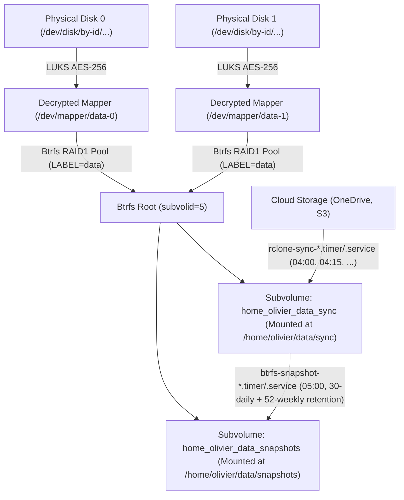

# Ansible Playbooks, Roles & Architecture Guide

This document describes the structure, variable hierarchy, playbooks, and roles used to manage servers and storage in the `homecode` repository.

---

## 🏗️ Storage & Security Architecture

The infrastructure runs on Debian hosts (`lab` and `live` environments). For hosts in the `crypto` inventory group, storage is structured as an encrypted layered stack:



### Technical Rationale & Storage Layers

1. **Multi-Device LUKS Layer (`/dev/mapper/<name>-<idx>`)**:
   - Each physical device declared in `devices` is encrypted individually as an independent LUKS container using AES-256 (`luks_pass`).
   - Decrypted virtual block devices are mapped as `/dev/mapper/<name>-0`, `/dev/mapper/<name>-1`, etc.
   - Each member device maintains its own isolated LUKS header backup in `/var/backups/luks/luks-header-<name>-<idx>.img`.

2. **Native Btrfs RAID1 Mirroring**:
   - For multi-device pools (`devices | length > 1`), Btrfs is formatted directly across all decrypted member devices with `-d raid1 -m raid1 -L <name>`.
   - Btrfs native RAID1 provides two copies of all data and metadata across distinct devices, offering self-healing checksum repair during read operations and monthly scrubs without requiring mdadm or hardware RAID.
   - For single-device pools (`devices | length == 1`), standard Btrfs profile is created.

3. **Label-Based Mounting & Flattened Subvolume Naming (`/etc/fstab`)**:
   - Btrfs pools are initialized with filesystem label `-L {{ disk_name }}`.
   - `btrfs device scan` registers all opened member mappers with the kernel.
   - Subvolumes are mounted in `/etc/fstab` using `src: "LABEL={{ disk_name }}"` (e.g. `LABEL=data`), guaranteeing clean pool assembly regardless of device enumeration order.
   - Each entry in `subvolumes` is an explicit absolute mount path (e.g. `/home/{{ ansible_user }}/data/sync`). Its internal Btrfs subvolume name is deterministically derived by flattening slashes into underscores (`home_olivier_data_sync`) and mounted with options `rw,async,noauto,nofail,compress=zstd:1,noatime,user_subvol_rm_allowed,subvol=<flattened_name>`.
   - `noauto,nofail`: Ensures the host boots reliably without emergency shell drops before encrypted LUKS containers are unlocked.
   - `user_subvol_rm_allowed`: Enables snapshot rotation by `ansible_user` without root elevation.

#### SMR Drive Optimization & Mount Options Rationale
Our storage configuration specifically accounts for mechanical SMR (Shingled Magnetic Recording) drives (e.g., Seagate Barracuda):
- **SMR Architecture Challenges**: SMR drives overlap data tracks like roof shingles to increase areal density. Modifying existing data requires reading an entire band of overlapping tracks into cache, modifying the target sectors, and rewriting the entire band sequentially (Read-Modify-Write cycle). To manage this, SMR drives use a small internal CMR (Conventional Magnetic Recording) write cache. If write bursts are too aggressive, erratic, or fragmented, the CMR cache quickly exhausts, forcing the drive firmware into synchronous on-disk band rewrites that cause severe I/O latency spikes and throughput collapse.
- **`rw,async` (Explicit Asynchronous I/O Baseline)**: While standard Linux mount options (`defaults`) include asynchronous I/O, Ansible's `mount` module rejects `defaults` when paired with `boot: false` due to an internal conflict with `auto`. We explicitly specify `rw,async` to lock the asynchronous baseline. Asynchronous I/O allows the Linux kernel page cache to buffer, aggregate, and reorder writes in RAM before dispatching them to the drive controller in large sequential flushes, preventing processes from stalling on slow physical shingled tracks.
- **`compress=zstd:1` (Ultra-Fast Compression)**: Lowered from `zstd:3` to `zstd:1`. Level 1 is the fastest Zstandard compression profile in Btrfs. While saving slightly less disk space than level 3, level 1 drastically cuts CPU latency and eliminates uneven write pauses. It streams compressed extents almost instantaneously into the kernel I/O queue, delivering a predictable, continuous data flow that allows the SMR drive's CMR cache to drain efficiently without saturating.
- **`noatime` (Read Metadata Optimization)**: Disables access time updates on read operations, eliminating unnecessary random metadata writes that would otherwise fragment SMR tracks and accelerate flash wear.
- **Omission of `autodefrag`**: Btrfs `autodefrag` is intentionally omitted. Background defragmentation causes severe write amplification and triggers constant, destructive Read-Modify-Write cycles across SMR shingle bands.
- **Rclone Transfer Throttling (`--transfers 2 --checkers 4 --buffer-size 32M --fast-list`)**: Configured in `rclone-sync-*.service` to pace inbound network transfers, preventing parallel sync threads from overwhelming both the Btrfs writeback queue and the SMR drive's CMR buffer cache.

4. **Systemd Backup Services & Timers (`rclone-sync-*` & `btrfs-snapshot-*`)**:
   - Instead of legacy `cron` jobs and wrapper scripts, both cloud synchronization (`rclone`) and local Btrfs snapshots (`snapshot`) are orchestrated by native `systemd.service` and `systemd.timer` units under `/etc/systemd/system/`.
   - Every Btrfs subvolume in `/etc/fstab` exposes a native systemd mount unit (e.g., `/home/olivier/data/sync` $\rightarrow$ `home-olivier-data-sync.mount`). Binding the backup services directly to these `.mount` units guarantees that backups never write to the root partition (`/`) when storage is locked after a reboot, and immediately terminates running jobs if storage is unmounted mid-run.

#### Reference: `systemd.service` and `systemd.timer` Directives & Security Intentions

| Section | Directive | Configured Value | Security & Reliability Intent |
| :--- | :--- | :--- | :--- |
| `[Unit]` | `After=` | `network-online.target <unit>.mount` | Ensures the network stack (for `rclone`) and the target Btrfs subvolume `.mount` unit(s) are fully online before starting the service. |
| `[Unit]` | `Wants=` | `network-online.target` | Pulls in network readiness checks so `rclone` does not start before routing/DNS are up. |
| `[Unit]` | `Requisite=` | `<unit>.mount` | **Pre-start lock protection**: If the Btrfs subvolume `.mount` unit is not currently active (e.g., after a reboot before `storage-unlock.yml` has been run), `systemd` immediately aborts the service (`Dependency failed`) **without** attempting to mount the locked LUKS device or writing a single byte to `/`. |
| `[Unit]` | `PartOf=` | `<unit>.mount` | **Live unmount kill-switch**: Couples the service's lifecycle to the `.mount` unit. If the Btrfs subvolume is unmounted while a sync or snapshot rotation is in progress, PID 1 immediately terminates the service's cgroup via `SIGTERM` (replacing fragile shell `sleep` polling loops). |
| `[Unit]` | `AssertPathIsMountPoint=` | `{{ item.mount_path }}` (and `{{ item.source }}` / `{{ item.destination }}`) | **Kernel VFS mountpoint assertion**: Verifies at the kernel VFS layer that the directory is an active mountpoint before running `ExecStartPre` or `ExecStart`. |
| `[Service]` | `Type=` | `oneshot` | Runs the backup command to completion before transitioning to inactive, and **natively prevents concurrent overlapping runs** of the same unit without needing `flock` lockfiles. |
| `[Service]` | `User=` / `Group=` | `{{ ansible_user }}` (`rclone`) / `root` (`snapshot`) | Runs `rclone` as the unprivileged user, and runs `snapshot.sh` with `CAP_SYS_ADMIN` so expired read-only (`ro`) Btrfs snapshots can be cleared and deleted reliably. |
| `[Service]` | `SyslogIdentifier=` | `rclone-sync-<name>` / `btrfs-snapshot-<name>` | Tags all standard output and error lines in `systemd-journald` for structured filtering and automatic log rotation (replacing manual `~/logs` files and `find -delete`). |
| `[Service]` | `NoNewPrivileges=` | `true` | Prevents the process and any child processes from acquiring additional privileges via `setuid`/`setgid` binaries or filesystem capabilities. |
| `[Service]` | `PrivateTmp=` | `true` | Assigns an isolated, private `/tmp` and `/var/tmp` mount namespace to the service that is automatically destroyed when the unit exits. |
| `[Service]` | `ProtectSystem=` | `strict` | Mounts the entire operating system hierarchy (`/`, `/usr`, `/boot`, `/etc`, `/var`) **read-only** inside the service's private mount namespace. |
| `[Service]` | `ProtectHome=` | `read-only` | Mounts `/home`, `/root`, and `/run/user` **read-only** inside the service's private mount namespace. |
| `[Service]` | `ReadWritePaths=` | `{{ item.mount_path }}` (+ `~/.config/rclone` for `rclone`) | Explicitly grants write access **only** to the target Btrfs subvolume (and `~/.config/rclone` so `rclone` can save refreshed OAuth2 tokens). For `btrfs-snapshot-*`, **even the source subvolume (`{{ item.source }}`) remains strictly read-only**! |
| `[Service]` | `ExecStartPre=` | `test -s ...`, `chmod 0600 ...`, `mkdir -p ...` | (`rclone` only) Fails fast if `rclone.conf` is missing or empty, enforces `0600` permissions on credentials prior to each run, and ensures the target directory exists (`mkdir -p "{{ item.target_dir }}"`). |
| `[Service]` | `ExecStart=` | `/usr/bin/rclone sync ...` / `snapshot.sh ...` | Executes `/usr/bin/rclone sync` directly without any shell wrapper (`--modify-window 1s`, `--delete-during`, `--create-empty-src-dirs`, `--delete-excluded`, `--retries 3`, `--low-level-retries 10`, `--timeout 5m`, `--contimeout 60s`, plus optional `--filter` and `extra_args`). |
| `[Timer]` | `OnCalendar=` | `*-*-* HH:MM:00` | Triggers daily execution at the configured local time (`Europe/Paris`, defaulting to `04:00` + 15 min/job for `rclone` and `05:00` for `snapshot`). |
| `[Timer]` | `Persistent=` | `true` | Stores the last trigger timestamp in `/var/lib/systemd/timers/` so missed executions while powered off are caught up when the server comes back online. |
| `[Install]` | `WantedBy=` | `timers.target` | Enables the timer automatically at boot as part of the standard systemd timer target. |

---

## 📁 Environments & Inventory Structure

Ansible configurations are partitioned under `ansible/envs/`:

- **`ansible/envs/lab/`**: Testing and development environment.
  - Hosts: `debian.delarche.fr` (`[crypto]`)
- **`ansible/envs/live/`**: Production home infrastructure.
  - Hosts: `kodlix.delarche.fr`, `zotac.delarche.fr` (`[crypto]`), `runner.delarche.fr` (`[runner]`)

Each environment contains:
- `inventory.ini`: Host declarations and group assignments (`crypto`, `runner`).
- `group_vars/all/main.yml`: Global variables common to all hosts in this environment.
- `host_vars/<hostname>/main.yml`: Public host-specific variables.
- `host_vars/<hostname>/vault.yml`: Encrypted secrets for the host.

---

## 🔑 Variables & Secrets Hierarchy

Understanding where variables are defined is essential for maintaining and provisioning hosts.

### 1. Global Variables (`ansible/envs/<env>/group_vars/all/main.yml`)
Defines shared settings across all hosts:
- `ansible_user`: Remote SSH and primary system username (e.g. `olivier`).

> [!NOTE]
> Python interpreter discovery is centralized in `ansible.cfg` via `interpreter_python = auto_silent`, automatically detecting `/usr/bin/python3` across target Debian systems.

### 2. Host Public Variables (`ansible/envs/<env>/host_vars/<hostname>/main.yml`)
Configures hardware layout and backup targets:
- `crypto_disks`: Declarative list of encrypted storage pools to manage (supports 0, 1, or multiple volumes). Each volume can contain 1 or N underlying physical disks (`devices: [...]`) and a mandatory list of absolute mount paths (`subvolumes: [...]`). When multiple devices are declared, Btrfs automatically formats native RAID1 (`-d raid1 -m raid1`):
  ```yaml
  crypto_disks:
    - name: data       # Semantic volume name (label: data, mappers: /dev/mapper/data-0, data-1...)
      devices:
        - /dev/disk/by-id/ata-debian-1_SSD_...
        # - /dev/disk/by-id/ata-debian-2_SSD_... (Optional: add 2nd disk for Btrfs RAID1)
      subvolumes:
        - "/home/{{ ansible_user }}/data/sync"
        - "/home/{{ ansible_user }}/data/snapshots"
  ```
- `snapshot_jobs`: Declarative list of Btrfs snapshot jobs scheduled via `systemd.timer` (`btrfs-snapshot-<name>.timer` / `.service`):
  ```yaml
  snapshot_jobs:
    - name: data
      source: "/home/{{ ansible_user }}/data/sync"
      destination: "/home/{{ ansible_user }}/data/snapshots"
      # optional retention & schedule:
      # keep_daily: 30
      # keep_weekly: 52
      # hour: 5
      # minute: 0
  ```
- `rclone_jobs`: List of cloud sync targets managed by native systemd units (`rclone-sync-<name>.timer` / `.service`). Each job must provide a unique `name`, a cloud `source`, and a local `destination`:
  ```yaml
  rclone_jobs:
    - name: onedrive-share-50ans
      source:
        provider: OneDrive
        path: Share/50ans
      destination:
        mount: "/home/{{ ansible_user }}/data/sync"
      extra_args:
        - '--user-agent="ISV|rclone.org|rclone/v1.67.0"'
      # optional schedule & filters:
      # hour: 4
      # minute: 0
      # filters:
      #   - "- .DS_Store"
    - name: custom-sync
      source:
        provider: S3
        path: delarche-images
      destination:
        mount: "/home/{{ ansible_user }}/data/sync"
        path: "custom/subfolder"
      extra_args:
        - "--drive-skip-gdocs"
  ```

  **Schema & Target Resolution Rules**:
  - `name`: Mandatory identifier matching `^[a-z0-9][a-z0-9-]*$`, unique across the host.
  - `source.provider`: Mandatory cloud provider matching a remote configured in `rclone.conf`.
  - `source.path`: Optional remote subpath or bucket.
  - `destination.mount`: Mandatory absolute path that must match one of the declared `crypto_disks[*].subvolumes`.
  - `destination.path`: Optional relative subpath (must not start with `/` or contain `..`).
  - Target directory is resolved to `<destination.mount>/<destination.path>` if `destination.path` is provided, otherwise `<destination.mount>/<source.provider>[/<source.path>]`.
  - Resolved target directories must be completely disjoint across all jobs (no two jobs may share or nest target directories).
  - Systemd mount unit dependencies (`Requisite=`, `PartOf=`, `After=`) are dynamically and safely escaped via `systemd-escape --path --suffix=mount`.
  - Stale or orphaned units (`/etc/systemd/system/rclone-sync-*.{service,timer}`) not present in `rclone_jobs` are stopped, disabled, and removed automatically during playbook runs.


### 3. Encrypted Secrets (`ansible/envs/<env>/host_vars/<hostname>/vault.yml`)
> [!IMPORTANT]
> All sensitive credentials and secrets are encrypted with `ansible-vault` (AES-256) using password file `~/.ansible_vault_pass`.

Each host's `vault.yml` defines:
- **`luks_pass`**: The disk encryption passphrase used by `cryptsetup` to format or open the LUKS containers.

#### Managing Vault Files:
A template is maintained in [`ansible/vault.yml.example`](../ansible/vault.yml.example).

To view secrets:
```bash
uv run ansible-vault view ansible/envs/lab/host_vars/debian.delarche.fr/vault.yml
```

To edit secrets:
```bash
uv run ansible-vault edit ansible/envs/lab/host_vars/debian.delarche.fr/vault.yml
```

To re-encrypt or create a new vault:
```bash
uv run ansible-vault encrypt ansible/envs/live/host_vars/newhost/vault.yml
```

---

## 📜 Playbooks Description & Workflows

### 1. `ansible/bootstrap.yml`
- **Purpose**: Initial bootstrap on a clean, minimal Debian install.
- **Prerequisite**: Deploy authorized SSH key beforehand via `ssh-copy-id {{ ansible_user }}@<host>` (or use `-k` to prompt for SSH password interactively).
- **Roles executed**: `apt`, `sudo`, `sshd`, and automatically imports `ansible/system.yml`.
- **Action**: Installs essential packages (`sudo`), configures user `{{ ansible_user }}` with sudo rights via `/etc/sudoers.d/99-ansible-wheel` (without managing or altering local Unix passwords), provisions authorized SSH keys, hardens SSH daemon, and applies complete OS baseline configuration.
- **Usage**:
  ```bash
  uv run ansible-playbook -i ansible/envs/lab/inventory.ini ansible/bootstrap.yml -K
  ```
  *(The `-K` flag interactively prompts for the `become` password in your terminal; passwords are never saved to disk or git).*

### 2. `ansible/system.yml`
- **Purpose**: System-wide baseline configuration, package management, security hardening, service management, GitHub Actions self-hosted runner provisioning/upgrades, and Samba file sharing with Previous Versions.
- **Target hosts**: Play 1 on `hosts: all`; Play 2 on `hosts: runner`; Play 3 on `hosts: crypto`.
- **Roles executed**: `apt`, `base`, `htop`, `locales`, `ntp`, `sshd`, `sudo`, `ufw`, `vim` (on `all`), `runner` (on `runner`), and `samba` (on `crypto`, tagged with `samba`).
- **Usage**:
  ```bash
  # Full system run across all hosts
  uv run ansible-playbook -i ansible/envs/live/inventory.ini ansible/system.yml

  # Target Samba service configuration only
  uv run ansible-playbook -i ansible/envs/live/inventory.ini ansible/system.yml --tags samba
  ```

### 3. `ansible/storage-unlock.yml`
- **Purpose**: Fast, non-destructive playbook used after server reboot to unlock LUKS containers and mount Btrfs subvolumes.
- **Target hosts**: `hosts: crypto`
- **Roles executed**: `crypto` (only decrypts LUKS, scans Btrfs devices, verifies headers, and mounts subvolumes).
- **Usage**:
  ```bash
  uv run ansible-playbook -i ansible/envs/live/inventory.ini ansible/storage-unlock.yml
  ```

### 4. `ansible/storage-wipe-and-reset.yml`
- **Purpose**: Destructive playbook used when provisioning new storage or resetting an entire storage pool.
- **Target hosts**: `hosts: crypto`
- **Safety**: Includes interactive confirmation prompt (or `-e "confirm_wipe=yes"`).
- **Action**: Unmounts subvolumes, formats LUKS on member devices, creates multi-device Btrfs RAID1 filesystem, creates subvolumes (`sync`, `snapshots`), and mounts in `/etc/fstab`.
- **Usage**:
  ```bash
  uv run ansible-playbook -i ansible/envs/lab/inventory.ini ansible/storage-wipe-and-reset.yml
  ```

### 5. `ansible/storage-replace.yml`
- **Purpose**: Guided workflow to replace a failed member disk in a Btrfs RAID1 pool.
- **Target hosts**: `hosts: crypto`
- **Workflow**: Auto-detects unformatted or closed devices across pools in `crypto_disks` (or targets a specific pool/member via `-e replace_pool=<pool> -e replace_index=<idx>`), ensures Btrfs is mounted (degraded if necessary), prompts for confirmation, formats LUKS, opens mapper, runs `btrfs replace start`, creates a LUKS header backup, and remounts all subvolumes cleanly.
- **Usage**:
  ```bash
  # Auto-detect unformatted/closed disk across all pools
  uv run ansible-playbook -i ansible/envs/lab/inventory.ini ansible/storage-replace.yml

  # Target a specific pool and member index explicitly
  uv run ansible-playbook -i ansible/envs/lab/inventory.ini ansible/storage-replace.yml -e replace_pool=data -e replace_index=0
  ```

### 6. `ansible/backup.yml`
- **Purpose**: Configures automated Btrfs snapshot and cloud synchronization `systemd` services and timers.
- **Target hosts**: `hosts: crypto`
- **Roles executed**:
  - `snapshot`: Deploys `/home/{{ ansible_user }}/bin/snapshot.sh` and configures `/etc/systemd/system/btrfs-snapshot-<name>.{service,timer}`.
  - `rclone`: Installs `rclone`, seeds local `~/.config/rclone/rclone.conf` if not already present (`force: false`, `mode: "0600"`, `no_log: true`), and configures `/etc/systemd/system/rclone-sync-<slug>.{service,timer}`.
- **Usage**:
  ```bash
  uv run ansible-playbook -i ansible/envs/live/inventory.ini ansible/backup.yml
  ```

### 7. `ansible/status.yml`
- **Purpose**: Non-destructive, read-only diagnostic playbook reporting base host identity/uptime, locales/keyboard layout, time/NTP synchronization, SSH daemon settings and authorized key fingerprints, UFW firewall status, LUKS container status, header backups, SMART health, Btrfs usage and error stats, `btrfs-snapshot-*` / `rclone-sync-*` systemd timers, `journald` logs, `rclone` remote configuration status, and GitHub Actions self-hosted runner health.
- **Roles executed**: Modularly imports status tasks from `base`, `locales`, `ntp`, `sshd`, `ufw` (`hosts: all`), `crypto`, `snapshot`, `rclone` (`hosts: crypto`), and `runner` (`hosts: runner`).
- **Usage**:
  ```bash
  # Full health report
  uv run ansible-playbook -i ansible/envs/lab/inventory.ini ansible/status.yml

  # Scoped queries using tags
  uv run ansible-playbook -i ansible/envs/lab/inventory.ini ansible/status.yml --tags base
  uv run ansible-playbook -i ansible/envs/lab/inventory.ini ansible/status.yml --tags locales
  uv run ansible-playbook -i ansible/envs/lab/inventory.ini ansible/status.yml --tags ntp
  uv run ansible-playbook -i ansible/envs/lab/inventory.ini ansible/status.yml --tags sshd
  uv run ansible-playbook -i ansible/envs/lab/inventory.ini ansible/status.yml --tags ufw
  uv run ansible-playbook -i ansible/envs/lab/inventory.ini ansible/status.yml --tags crypto
  uv run ansible-playbook -i ansible/envs/lab/inventory.ini ansible/status.yml --tags snapshot
  uv run ansible-playbook -i ansible/envs/lab/inventory.ini ansible/status.yml --tags rclone
  uv run ansible-playbook -i ansible/envs/live/inventory.ini ansible/status.yml --limit runner.delarche.fr --tags runner
  ```

---

## 🚑 Disaster Recovery, CI/CD & Verification Guides

- 👉 **[macOS User Guide: File Sharing & Snapshots](mac-user-guide.md)**: Finder SMB3 connection, Previous Versions snapshot navigation, and automated Mac backups via `rsync` over SSH.
- 👉 **[GitHub Actions CI/CD & Self-Hosted Runner Setup Guide](github-ci-runner-setup.md)**: Two-stage pipeline architecture, `local-runner` protection gate, and `runner.delarche.fr` setup.
- 👉 **[Disaster Recovery & Storage Operations Guide](disaster-recovery.md)**: Manual unlock without Ansible, snapshot restoration, and LUKS header restoration from `/var/backups/luks/`.
- 👉 **[Test Book & Non-Regression Verification Guide](testing.md)**: Full catalog of test cards (`TC-QA`, `TC-SYS`, `TC-FW`, `TC-STO`, `TC-BAK`, `TC-SMB`, `TC-ADV`) and master non-regression runbook.

---

## 🧩 Roles Breakdown

| Role | Description | Key Managed Files / Services |
| :--- | :--- | :--- |
| **`apt`** | Ensures `sudo` and package tools are installed; upgrades system package cache; configures automatic security updates (`unattended-upgrades`). | `apt` cache, `/etc/apt/apt.conf.d/20auto-upgrades` |
| **`base`** | Installs common utilities (`bash-completion`, `curl`, `git`, `man-db`, `rsync`, `tree`, `unzip`, `wget`), configures the live system hostname via `ansible.builtin.hostname`, and installs customized `.bashrc`. | `/etc/hostname`, `~/.bashrc`, `/root/.bashrc` |
| **`crypto`** | Manages the full encrypted storage stack across 0, 1, or N volumes (`crypto_disks`) with single or multi-device Btrfs native RAID1: per-device LUKS format/open via memory/stdin, automated LUKS header backups (`/var/backups/luks/`), kernel device scanning (`btrfs device scan`), direct Btrfs formatting with semantic labels and automatic RAID1 mirroring, declarative absolute subvolume mounts with flattened internal subvolume names and zstd compression, label-based fstab integration (`LABEL=<name>`), and monthly Btrfs scrub cron. | `/dev/mapper/<name>-<idx>`, `/var/backups/luks/`, `/etc/fstab` |
| **`htop`** | Installs `htop` and seeds initial user configuration (`force: false`). | `~/.config/htop/htoprc` |
| **`locales`** | Generates `en_US.UTF-8` and `fr_FR.UTF-8` locales, configures English system UI (`LANG=en_US.UTF-8`) with French regional categories (`LC_TIME`, `LC_MEASUREMENT`, `LC_PAPER`, `LC_MONETARY=fr_FR.UTF-8`) in `/etc/locale.conf` (symlinked from `/etc/default/locale`), and configures French AZERTY keyboard (`fr`/`latin9`). | `/etc/locale.conf`, `/etc/default/locale`, `/etc/default/keyboard` |
| **`ntp`** | Sets timezone (`Europe/Paris`) and configures `chrony` (`fr.pool.ntp.org`, `rtcsync`, `leapseclist`, and `leapsecmode slew` for monotonic leap seconds). | `/etc/chrony/chrony.conf`, `tzdata`, `chrony` service |
| **`rclone`** | Installs `rclone`, seeds local `~/.config/rclone/rclone.conf` if not already present (`force: false`, `mode: "0600"`, `no_log: true`), and deploys sandboxed `systemd` service and timer units (`rclone-sync-<slug>.{service,timer}`) invoking `/usr/bin/rclone sync` directly with kernel mount protection (`Requisite=`, `BindsTo=`, `AssertPathIsMountPoint=`) and `ProtectSystem=strict`. | `~/.config/rclone/rclone.conf`, `/etc/systemd/system/rclone-sync-*.{service,timer}` |
| **`runner`** | Installs CI/CD and .NET runtime dependencies (`git`, `curl`, `jq`, `shellcheck`, `rsync`, `libicu-dev`, `libssl-dev`), copies local `~/.ansible_vault_pass` (`mode: "0600"`, `no_log: true`) and `~/.config/rclone/rclone.conf` (`mode: "0600"`, `no_log: true`), generates `/home/{{ ansible_user }}/.ssh/id_ed25519` on the runner, adds `debian.delarche.fr` to `known_hosts`, authorizes the runner's public key on `debian.delarche.fr`, and installs/upgrades the official GitHub Actions Runner (`actions/runner`) release in `/opt/actions-runner`. | `/opt/actions-runner`, `~/.ansible_vault_pass`, `~/.config/rclone/rclone.conf`, `~/.ssh/id_ed25519` |
| **`samba`** | Deploys Samba SMB3 service on `crypto` hosts: serves Btrfs subvolumes in read-only mode with native Windows and macOS Previous Versions support via `vfs_shadow_copy2` mapped to `btrfs-snapshot` retention directories, provisions vault-encrypted credentials via `smbpasswd`, ensures `~/data/sync/mac` target directory exists when mounted, and configures LAN-restricted UFW firewall rules (port 445/tcp). | `/etc/samba/smb.conf`, `smbd` service, `/home/{{ ansible_user }}/data/sync/mac` |
| **`snapshot`** | Manages Btrfs snapshot automation: deploys streamlined `/home/{{ ansible_user }}/bin/snapshot.sh` (30 daily + 52 weekly ISO retention) and configures sandboxed `systemd` service and timer units (`btrfs-snapshot-<name>.{service,timer}`) with dual mount binding and read-only source protection (`ProtectSystem=strict`, `ReadWritePaths={{ item.destination }}`). | `/home/{{ ansible_user }}/bin/snapshot.sh`, `/etc/systemd/system/btrfs-snapshot-*.{service,timer}` |
| **`sshd`** | Automatically discovers all local `~/.ssh/*.pub` public keys and ensures they are present in `~/.ssh/authorized_keys` (`exclusive: false`), and hardens `/etc/ssh/sshd_config` (disables root login and password authentication, validated via `sshd -t -f %s`). | `/etc/ssh/sshd_config`, `~/.ssh/authorized_keys` |
| **`sudo`** | Creates `wheel` group, configures `/etc/sudoers.d/99-ansible-wheel` (validated via `visudo`), and configures user `{{ ansible_user }}` with wheel group membership and bash shell without managing local passwords. | `/etc/sudoers.d/99-ansible-wheel`, `/etc/passwd` |
| **`ufw`** | Configures declarative dual-stack (IPv4/IPv6) packet filtering via `community.general.ufw` (`ufw_rules`), sets default policies (`incoming: deny`, `outgoing: allow`, `routed: deny`), cleans legacy `/etc/network/iptables.up.rules`, and enables `ufw.service` at boot. | `/etc/default/ufw`, `/etc/ufw/user.rules`, `/etc/ufw/user6.rules`, `ufw` service |
| **`vim`** | Installs `vim`, sets `/usr/bin/vim.basic` as default system `editor`, and provisions `.vimrc` (with `defaults.vim` and disabled mouse capture) for regular user and root. | `~/.vimrc`, `/root/.vimrc`, `editor` alternative |
