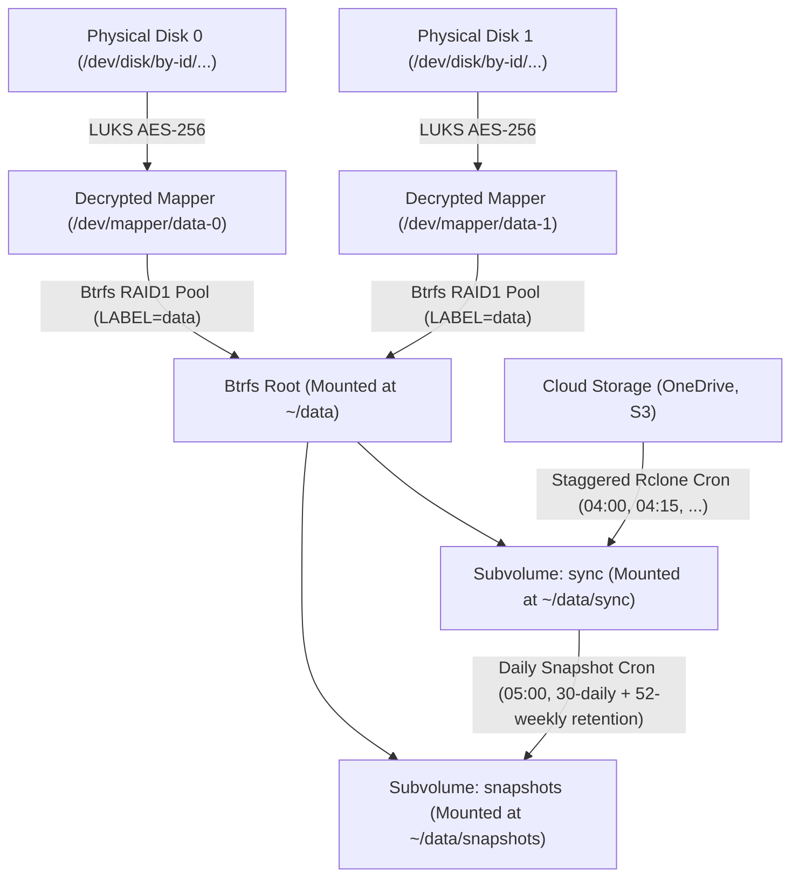

# Ansible Playbooks, Roles & Architecture Guide

This document describes the structure, variable hierarchy, playbooks, and roles used to manage servers and storage in the `homecode` repository.

---

## 🏗️ Storage & Security Architecture

The infrastructure runs on Debian hosts (`lab` and `live` environments). For hosts in the `crypto` inventory group, storage is structured as an encrypted layered stack:



### Technical Rationale & Storage Layers

1. **Multi-Device LUKS Layer (`/dev/mapper/<name>-<idx>`)**:
   - Each physical device declared in `devices` is encrypted individually as an independent LUKS container using AES-256 (`luks_pass`).
   - Decrypted virtual block devices are mapped as `/dev/mapper/<name>-0`, `/dev/mapper/<name>-1`, etc.
   - Each member device maintains its own isolated LUKS header backup in `/var/backups/luks/luks-header-<name>-<idx>.img`.

2. **Native Btrfs RAID1 Mirroring**:
   - For multi-device pools (`devices | length > 1`), Btrfs is formatted directly across all decrypted member devices with `-d raid1 -m raid1 -L <name>`.
   - Btrfs native RAID1 provides two copies of all data and metadata across distinct devices, offering self-healing checksum repair during read operations and monthly scrubs without requiring mdadm or hardware RAID.
   - For single-device pools (`devices | length == 1`), standard Btrfs profile is created.

3. **Label-Based Mounting & Dynamic Discovery (`/etc/fstab`)**:
   - Btrfs pools are initialized with filesystem label `-L {{ disk_name }}`.
   - `btrfs device scan` registers all opened member mappers with the kernel.
   - Subvolumes are mounted in `/etc/fstab` using `src: "LABEL={{ disk_name }}"` (e.g. `LABEL=data`), guaranteeing clean pool assembly regardless of device enumeration order.
   - Subvolumes are nested within the volume directory at `{{ crypto_base_dir }}/<disk_name>/<subvol>` (e.g. `{{ crypto_base_dir }}/data/sync`, `{{ crypto_base_dir }}/data/snapshots`) with options `noauto,nofail,compress=zstd:3,noatime,user_subvol_rm_allowed,subvol=<subvol>`.
   - `noauto,nofail`: Ensures the host boots reliably without emergency shell drops before encrypted LUKS containers are unlocked.
   - `user_subvol_rm_allowed`: Enables snapshot rotation by `ansible_user` without root elevation.
   - `compress=zstd:3`: Transparent filesystem-level compression reducing flash wear and disk space usage.
   - `noatime`: Eliminates metadata write overhead on read operations.

---

## 📁 Environments & Inventory Structure

Ansible configurations are partitioned under `ansible/envs/`:

- **`ansible/envs/lab/`**: Testing and development environment.
  - Hosts: `debian.delarche.fr`
- **`ansible/envs/live/`**: Production home infrastructure.
  - Hosts: `kodlix.delarche.fr`, `zotac.delarche.fr`

Each environment contains:
- `inventory.ini`: Host declarations and group assignments (`crypto`).
- `group_vars/all/main.yml`: Global variables common to all hosts in this environment.
- `host_vars/<hostname>/main.yml`: Public host-specific variables.
- `host_vars/<hostname>/vault.yml`: Encrypted secrets for the host.

---

## 🔑 Variables & Secrets Hierarchy

Understanding where variables are defined is essential for maintaining and provisioning hosts.

### 1. Global Variables (`ansible/envs/<env>/group_vars/all/main.yml`)
Defines shared settings across all hosts:
- `ansible_user`: Remote SSH and primary system username (e.g. `olivier`).
- `crypto_base_dir`: Base destination path for decrypted mounts (default: `"/home/{{ ansible_user }}"`).

> [!NOTE]
> Python interpreter discovery is centralized in `ansible.cfg` via `interpreter_python = auto_silent`, automatically detecting `/usr/bin/python3` across target Debian systems.

### 2. Host Public Variables (`ansible/envs/<env>/host_vars/<hostname>/main.yml`)
Configures hardware layout and backup targets:
- `crypto_disks`: Declarative list of encrypted storage pools to manage (supports 0, 1, or multiple volumes). Each volume can contain 1 or N underlying physical disks (`devices: [...]`). When multiple devices are declared, Btrfs automatically formats native RAID1 (`-d raid1 -m raid1`). If `subvolumes` is omitted, it defaults to `btrfs_default_subvolumes` (`sync` and `snapshots`), nested under `{{ crypto_base_dir }}/<name>/`:
  ```yaml
  crypto_disks:
    - name: data       # Semantic volume name (label: data, mappers: /dev/mapper/data-0, data-1...)
      devices:
        - /dev/disk/by-id/ata-debian-1_SSD_...
        # - /dev/disk/by-id/ata-debian-2_SSD_... (Optional: add 2nd disk for Btrfs RAID1)
      # Optional: custom subvolumes (defaults to sync & snapshots under crypto_base_dir/data)
      # subvolumes:
      #   - name: sync
      #   - name: snapshots
  ```
- `snapshot_jobs`: Declarative list of Btrfs snapshot jobs scheduled via crontab:
  ```yaml
  snapshot_jobs:
    - name: data
      source: "{{ crypto_base_dir }}/data/sync"
      destination: "{{ crypto_base_dir }}/data/snapshots"
      # optional retention & schedule:
      # keep_daily: 30
      # keep_weekly: 52
      # hour: "5"
      # minute: "0"
  ```
- `rclone_jobs`: List of cloud remotes and buckets to sync via rclone:
  ```yaml
  rclone_jobs:
    - provider: onedrive
      bucket: ""
    - provider: S3
      bucket: delarche-images
  ```

### 3. Encrypted Secrets (`ansible/envs/<env>/host_vars/<hostname>/vault.yml`)
> [!IMPORTANT]
> All sensitive credentials and secrets are encrypted with `ansible-vault` (AES-256) using password file `~/.ansible_vault_pass`.

Each host's `vault.yml` defines:
- **`luks_pass`**: The disk encryption passphrase used by `cryptsetup` to format or open the LUKS containers.

#### Managing Vault Files:
A template is maintained in [`ansible/vault.yml.example`](../ansible/vault.yml.example).

To view secrets:
```bash
uv run ansible-vault view ansible/envs/lab/host_vars/debian.delarche.fr/vault.yml
```

To edit secrets:
```bash
uv run ansible-vault edit ansible/envs/lab/host_vars/debian.delarche.fr/vault.yml
```

To re-encrypt or create a new vault:
```bash
uv run ansible-vault encrypt ansible/envs/live/host_vars/newhost/vault.yml
```

---

## 📜 Playbooks Description & Workflows

### 1. `ansible/bootstrap.yml`
- **Purpose**: Initial bootstrap on a clean, minimal Debian install.
- **Prerequisite**: Deploy authorized SSH key beforehand via `ssh-copy-id {{ ansible_user }}@<host>` (or use `-k` to prompt for SSH password interactively).
- **Roles executed**: `apt`, `sudo`, `sshd`, and automatically imports `ansible/system.yml`.
- **Action**: Installs essential packages (`sudo`), configures user `{{ ansible_user }}` with sudo rights via `/etc/sudoers.d/99-ansible-wheel` (without managing or altering local Unix passwords), provisions authorized SSH keys, hardens SSH daemon, and applies complete OS baseline configuration.
- **Usage**:
  ```bash
  uv run ansible-playbook -i ansible/envs/lab/inventory.ini ansible/bootstrap.yml -K
  ```
  *(The `-K` flag interactively prompts for the `become` password in your terminal; passwords are never saved to disk or git).*

### 2. `ansible/system.yml`
- **Purpose**: System-wide baseline configuration, package management, security hardening, and service management. Completely decoupled from storage management.
- **Target hosts**: `hosts: all`
- **Roles executed**: `apt`, `base`, `htop`, `iptables`, `locales`, `ntp`, `sshd`, `sudo`, `vim`.
- **Usage**:
  ```bash
  uv run ansible-playbook -i ansible/envs/live/inventory.ini ansible/system.yml
  ```

### 3. `ansible/storage-unlock.yml`
- **Purpose**: Fast, non-destructive playbook used after server reboot to unlock LUKS containers and mount Btrfs subvolumes.
- **Target hosts**: `hosts: crypto`
- **Roles executed**: `crypto` (only decrypts LUKS, scans Btrfs devices, verifies headers, and mounts subvolumes).
- **Usage**:
  ```bash
  uv run ansible-playbook -i ansible/envs/live/inventory.ini ansible/storage-unlock.yml
  ```

### 4. `ansible/storage-wipe-and-reset.yml`
- **Purpose**: Destructive playbook used when provisioning new storage or resetting an entire storage pool.
- **Target hosts**: `hosts: crypto`
- **Safety**: Includes interactive confirmation prompt (or `-e "confirm_wipe=yes"`).
- **Action**: Unmounts subvolumes, formats LUKS on member devices, creates multi-device Btrfs RAID1 filesystem, creates subvolumes (`sync`, `snapshots`), and mounts in `/etc/fstab`.
- **Usage**:
  ```bash
  uv run ansible-playbook -i ansible/envs/lab/inventory.ini ansible/storage-wipe-and-reset.yml
  ```

### 5. `ansible/storage-replace.yml`
- **Purpose**: Guided workflow to replace a failed member disk in a Btrfs RAID1 pool.
- **Target hosts**: `hosts: crypto`
- **Workflow**: Auto-detects the new device from `host_vars`, ensures Btrfs is mounted (degraded if necessary), prompts for confirmation, formats LUKS, opens mapper, runs `btrfs replace start`, and creates a LUKS header backup.
- **Usage**:
  ```bash
  uv run ansible-playbook -i ansible/envs/lab/inventory.ini ansible/storage-replace.yml
  ```

### 6. `ansible/backup.yml`
- **Purpose**: Configures automated backup schedules and synchronization jobs.
- **Target hosts**: `hosts: crypto`
- **Roles executed**: `snapshot` (installs `snapshot.sh` and crontabs), `rclone` (installs `rclone.sh` and crontabs).
- **Usage**:
  ```bash
  uv run ansible-playbook -i ansible/envs/live/inventory.ini ansible/backup.yml
  ```

### 7. `ansible/status.yml`
- **Purpose**: Non-destructive, read-only diagnostic playbook reporting LUKS container status, header backups, SMART health, Btrfs usage and error stats, recent snapshots, and recent rclone logs.
- **Roles executed**: Modularly imports status tasks from `crypto`, `snapshot`, and `rclone` roles.
- **Usage**:
  ```bash
  # Full health report
  uv run ansible-playbook -i ansible/envs/lab/inventory.ini ansible/status.yml

  # Scoped queries using tags
  uv run ansible-playbook -i ansible/envs/lab/inventory.ini ansible/status.yml --tags crypto
  uv run ansible-playbook -i ansible/envs/lab/inventory.ini ansible/status.yml --tags snapshot
  uv run ansible-playbook -i ansible/envs/lab/inventory.ini ansible/status.yml --tags rclone
  ```

---

## 🚑 Disaster Recovery & Emergency Operations

For manual recovery instructions without Ansible, snapshot restoration, or LUKS header restoration from `/var/backups/luks/`, see the dedicated guide:
👉 **[Disaster Recovery & Storage Operations Guide](disaster-recovery.md)**

---

## 🧩 Roles Breakdown

| Role | Description | Key Managed Files / Services |
| :--- | :--- | :--- |
| **`apt`** | Ensures `sudo` and package tools are installed; upgrades system package cache; configures automatic security updates (`unattended-upgrades`). | `apt` cache, `/etc/apt/apt.conf.d/20auto-upgrades` |
| **`base`** | Installs common utilities (`curl`, `rsync`, `tree`, `wget`, etc.), sets `/etc/hostname`, and installs customized `.bashrc`. | `/etc/hostname`, `~/.bashrc`, `/root/.bashrc` |
| **`crypto`** | Manages the full encrypted storage stack across 0, 1, or N volumes (`crypto_disks`) with single or multi-device Btrfs native RAID1: per-device LUKS format/open via memory/stdin, automated LUKS header backups (`/var/backups/luks/`), kernel device scanning (`btrfs device scan`), direct Btrfs formatting with semantic labels and automatic RAID1 mirroring, declarative subvolumes (`sync`, `snapshots`) with zstd compression and label-based fstab integration (`LABEL=<name>`), and monthly Btrfs scrub cron. | `/dev/mapper/<name>-<idx>`, `/var/backups/luks/`, `/etc/fstab` |
| **`htop`** | Installs `htop` and user configuration. | `~/.config/htop/htoprc` |
| **`iptables`** | Sets up packet filtering firewall rules and restore handler. | `/etc/network/iptables.up.rules` |
| **`locales`** | Configures system locales (`en_US.UTF-8`, `fr_FR.UTF-8`). | `/etc/default/locale`, `/etc/locale.gen` |
| **`ntp`** | Sets timezone (`Europe/Paris`) and configures time synchronization (`chrony` on Debian 12+, `ntp` on Debian <= 11). | `tzdata`, `chrony`/`ntp` service |
| **`rclone`** | Installs `rclone`, sets up sync wrapper script (`rclone.sh` with 30-day log rotation), and configures staggered cron jobs for scheduled cloud backups. | `rclone.sh`, user crontab |
| **`snapshot`** | Manages Btrfs snapshot automation: installs reusable CLI script (`{{ crypto_base_dir }}/bin/snapshot.sh`), and configures declarative crontabs (`snapshot_jobs`) with parallel execution safety (per-destination lockfiles) and configurable retention (30 daily + 52 weekly). | `{{ crypto_base_dir }}/bin/snapshot.sh`, user crontab |
| **`sshd`** | Hardens SSH configuration (disables root login, disables password authentication) and manages `authorized_keys`. | `/etc/ssh/sshd_config`, `~/.ssh/authorized_keys` |
| **`sudo`** | Creates `wheel` group, configures `/etc/sudoers.d/99-ansible-wheel` (validated via `visudo`), and configures user `{{ ansible_user }}` with wheel group membership and bash shell without managing local passwords. | `/etc/sudoers.d/99-ansible-wheel`, `/etc/passwd` |
| **`vim`** | Installs `vim` and provisions `.vimrc` for regular user and root. | `~/.vimrc`, `/root/.vimrc` |
