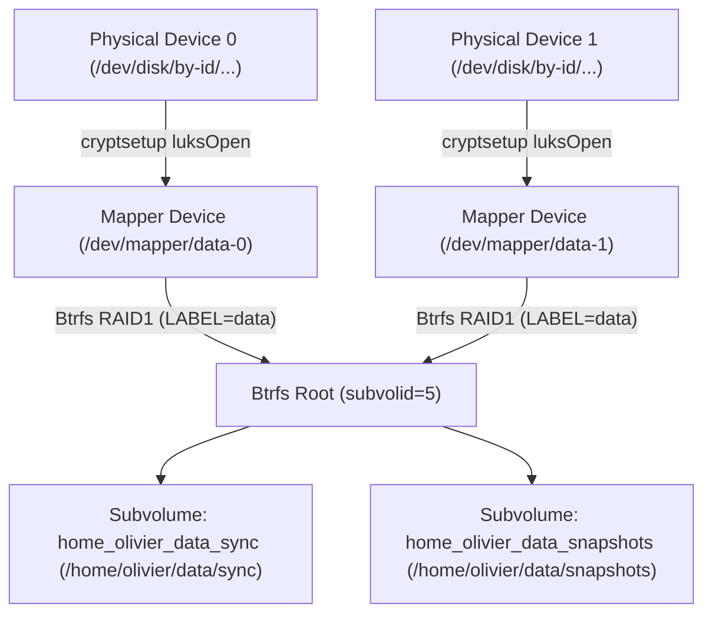

# 🚑 Disaster Recovery & Storage Operations Guide

This guide provides step-by-step procedures for emergency recovery, data restoration, LUKS header restoration, and hardware replacement for systems managed by the `domus` infrastructure.

---

## 🏗️ Storage Stack Summary

Each encrypted server (`debian.delarche.fr`, `kodlix.delarche.fr`, `zotac.delarche.fr`) uses the following layered stack:



- **Passphrase**: Encrypted in Ansible Vault as `luks_pass`.
- **LUKS Header Backup**: Saved locally at `/var/backups/luks/luks-header-<name>-<idx>.img` (permissions `0400`).
- **Filesystem Label**: Matches the storage volume name (e.g. `data`), mounted via `LABEL=data`.

---

## 🚨 Scenario 1: Emergency Manual Unlock Without Ansible

If Ansible is unavailable, or if booting into a Debian Live USB or rescue environment:

### 1. Identify the block device
```bash
ls -l /dev/disk/by-id/
```

### 2. Decrypt and open the LUKS containers
For each physical disk in the pool:
```bash
sudo cryptsetup luksOpen /dev/disk/by-id/<disk-1-id> data-0
sudo cryptsetup luksOpen /dev/disk/by-id/<disk-2-id> data-1  # If RAID1 pool
```
*(Enter the `luks_pass` passphrase when prompted).*

Scan opened member devices into the kernel Btrfs pool:
```bash
sudo btrfs device scan
```

### 3. Mount the Btrfs subvolumes
Mount by label (`LABEL=data`) so Btrfs automatically mounts the complete pool (internal subvolume names flatten the absolute mount path with underscores):
```bash
sudo mkdir -p /mnt/recovery/data/sync /mnt/recovery/data/snapshots

# Mount the sync working tree
sudo mount -t btrfs -o subvol=home_olivier_data_sync,compress=zstd:1,noatime LABEL=data /mnt/recovery/data/sync

# Mount the snapshots tree
sudo mount -t btrfs -o subvol=home_olivier_data_snapshots,compress=zstd:1,noatime LABEL=data /mnt/recovery/data/snapshots
```

### 4. Unmount and close after operations
```bash
sudo umount /mnt/recovery/data/sync
sudo umount /mnt/recovery/data/snapshots
sudo cryptsetup luksClose data-0
sudo cryptsetup luksClose data-1  # If RAID1 pool
```

---

## 🔄 Scenario 2: Restoring Files from Btrfs Snapshots

Snapshots are stored as read-only Btrfs subvolumes under `~/data/snapshots/` in the format `YYYY-MM-DD--HH-MM-SS`.

### 1. List available snapshots
```bash
ls -lt ~/data/snapshots/
```

### 2. Restore an individual file or directory
Because snapshots are regular read-only directory trees, you can copy or `rsync` files directly back to `~/data/sync/`:

```bash
# Example: restoring a deleted directory
rsync -aHAXv ~/data/snapshots/2026-09-24--09-06-44/path/to/folder/ ~/data/sync/path/to/folder/
```

### 3. Trigger a manual snapshot
You can trigger an ad-hoc snapshot at any time via the systemd service (or the CLI script):

```bash
sudo systemctl start btrfs-snapshot-data.service
```
Or directly with custom retention (e.g. 14 daily, 8 weekly):
```bash
sudo "$HOME/bin/snapshot.sh" "$HOME/data/sync" "$HOME/data/snapshots" 14 8
```

---

## 🛡️ Scenario 3: Corrupted LUKS Header Recovery

The LUKS on-disk header contains the cipher parameters, salt, and keyslots. If bad sectors develop or the header is accidentally overwritten, data cannot be decrypted even with the correct passphrase.

The `crypto` role automatically maintains a header backup for each member device at `/var/backups/luks/luks-header-<name>-<idx>.img`.

### 1. Verify header corruption
```bash
sudo cryptsetup luksDump /dev/disk/by-id/<disk-id>
```
If this returns `Device is not a valid LUKS device`, the header is corrupted.

### 2. Restore the header from backup
```bash
sudo cryptsetup luksHeaderRestore /dev/disk/by-id/<disk-id> \
  --header-backup-file /var/backups/luks/luks-header-<name>-<idx>.img
```
Type `YES` in uppercase when prompted to confirm restoration.

### 3. Verify access
```bash
sudo cryptsetup luksOpen /dev/disk/by-id/<disk-id> <name>-<idx>
```

---

## 🖴 Scenario 4: Physical Disk Replacement

When replacing a failed hard drive or SSD:

### Case A: Replacing a member disk in a Btrfs RAID1 Pool (Online, Zero Data Loss)

If the storage pool uses Btrfs RAID1 mirroring across multiple disks, data is safely mirrored on the surviving members:

1. **Install the new physical disk and retrieve its persistent ID**:
   ```bash
   ls -l /dev/disk/by-id/
   ```

2. **Update host variables**:
   Edit `ansible/envs/<env>/host_vars/<hostname>/main.yml` and replace the failed disk ID with the new disk ID under `crypto_disks`:
   ```yaml
   crypto_disks:
     - name: data
       devices:
         - /dev/disk/by-id/ata-Samsung_SSD_870_EVO_<surviving_disk>
         - /dev/disk/by-id/ata-Samsung_SSD_870_EVO_<new_replacement_disk>
       subvolumes:
         - "/home/{{ ansible_user }}/data/sync"
         - "/home/{{ ansible_user }}/data/snapshots"
   ```

3. **Run the guided replacement playbook**:
   ```bash
   uv run ansible-playbook -i ansible/envs/<env>/inventory.ini ansible/storage-replace.yml
   ```
   This automated workflow:
   - Detects the unformatted replacement disk in `crypto_disks` (or targets a specific pool/member via `-e replace_pool=<pool> -e replace_index=<idx>`).
   - Prompts for explicit confirmation before proceeding.
   - Formats LUKS on the new disk with `luks_pass` and opens `/dev/mapper/<pool>-<idx>`.
   - Mounts the filesystem degraded if a missing drive prevented standard mounting.
   - Triggers `btrfs replace start` to stream mirrored data from surviving disks into the new disk.
   - Saves a new LUKS header backup to `/var/backups/luks/` and remounts all subvolumes cleanly.

4. **Verify replacement status**:
   ```bash
   sudo btrfs replace status /home/olivier/data/sync
   uv run ansible-playbook -i ansible/envs/<env>/inventory.ini ansible/status.yml --tags crypto
   ```

---

### Case B: Complete Storage Reset or Single-Disk Replacement (Destructive)

When replacing all disks simultaneously or resetting an entire pool from scratch:

1. **Update host variables** with all new device IDs in `ansible/envs/<env>/host_vars/<hostname>/main.yml`.

2. **Run the reset playbook**:
   ```bash
   uv run ansible-playbook -i ansible/envs/<env>/inventory.ini ansible/storage-wipe-and-reset.yml
   ```
   *(Prompts for explicit `WIPE` confirmation).*

3. **Deploy backup jobs**:
   ```bash
   uv run ansible-playbook -i ansible/envs/<env>/inventory.ini ansible/backup.yml
   ```

4. **Trigger initial cloud sync**:
   ```bash
   sudo systemctl start rclone-sync-onedrive-share-50ans.service
   sudo systemctl start rclone-sync-s3-delarche-images.service
   ```

---

## 🩺 Scenario 5: Routine Integrity Verification (Btrfs Scrub)

A monthly scrub cron job is automatically configured. To manually run and check data integrity against bit rot:

```bash
# Start scrub in foreground with progress
sudo btrfs scrub start -B ~/data/sync

# Check last scrub status and error counters
sudo btrfs scrub status ~/data/sync
```
Verify that `csum_errors`, `verify_errors`, and `uncorrectable_errors` report `0`.

---

## 🗑️ Scenario 6: Manual Decommissioning / Deletion of an Encrypted Disk or RAID Pool

Use this procedure when permanently decommissioning, repurposing, or removing an encrypted disk or an entire Btrfs RAID pool without intending to restore it.

### Phase 1: Pre-Checks & Dependency Teardown

1. **Identify mappers, mount points, and physical block devices**:
   ```bash
   # List active block devices and LUKS mappers
   lsblk -o NAME,TYPE,FSTYPE,SIZE,MOUNTPOINTS

   # Check filesystem label and active mounts
   findmnt -t btrfs
   ```

2. **Stop dependent background services and timers**:
   Stop any systemd timers and services that access the storage pool to prevent I/O errors or automatic job triggers:
   ```bash
   # Stop snapshot services and timers for this pool
   sudo systemctl stop btrfs-snapshot-<pool>.service btrfs-snapshot-<pool>.timer

   # Stop cloud sync timers if backing up from/to this pool
   sudo systemctl stop rclone-sync-*.service rclone-sync-*.timer

   # If shared via Samba, stop or reload smbd
   sudo systemctl stop smbd.service
   ```

3. **Verify active file handles and processes**:
   Ensure no process is holding open files or directories on any of the mount points:
   ```bash
   # Check for open file handles on mount points (repeat for each mount point)
   sudo fuser -mv /path/to/mountpoint
   ```
   If any processes are listed, terminate them cleanly before proceeding.

---

### Phase 2: Teardown & Metadata Wiping

Choose **Case A** for a single standalone encrypted disk, or **Case B** for a multi-disk RAID pool.

#### Case A: Single Encrypted Disk (Non-RAID)

Assuming pool `<pool>` with mapper `<pool>-0` on underlying physical disk `/dev/disk/by-id/<disk-id>` mounted at `/path/to/mount`:

1. **Unmount the subvolumes / filesystem**:
   ```bash
   sudo umount /path/to/mount
   ```

2. **Deregister the Btrfs device from the kernel scan cache**:
   ```bash
   sudo btrfs device scan --forget /dev/mapper/<pool>-0
   ```

3. **Close the LUKS encrypted container**:
   ```bash
   sudo cryptsetup luksClose <pool>-0
   ```
   Verify the mapper is closed:
   ```bash
   ls -l /dev/mapper/<pool>-0
   # Should report: No such file or directory
   ```

4. **Wipe filesystem and partition signatures**:
   ```bash
   sudo wipefs -a /dev/disk/by-id/<disk-id>
   ```

5. **Wipe LUKS headers and superblock metadata**:
   Zero out the first 32 MiB of the physical device to permanently erase the LUKS header and keyslots:
   ```bash
   sudo dd if=/dev/zero of=/dev/disk/by-id/<disk-id> bs=1M count=32 status=progress conv=fdatasync
   ```

---

#### Case B: Multi-Disk Member Pool (Btrfs RAID1)

Assuming pool `<pool>` with multiple member disks (e.g. `/dev/disk/by-id/<disk1>`, `/dev/disk/by-id/<disk2>`) and mappers `<pool>-0`, `<pool>-1`:

1. **Unmount all subvolumes belonging to the pool**:
   ```bash
   # Unmount all subvolumes mounted from this pool label
   for mp in $(awk -v l="LABEL=<pool>" '$1 == l {print $2}' /etc/fstab); do
     sudo umount "$mp"
   done
   ```

2. **Deregister Btrfs devices and close all LUKS mappers**:
   ```bash
   for mapper in <pool>-0 <pool>-1; do
     sudo btrfs device scan --forget "/dev/mapper/${mapper}" 2>/dev/null || true
     sudo cryptsetup luksClose "${mapper}"
   done
   ```

3. **Wipe filesystem signatures and headers across all member physical devices**:
   ```bash
   for dev in /dev/disk/by-id/<disk1> /dev/disk/by-id/<disk2>; do
     sudo wipefs -a "$dev"
     sudo dd if=/dev/zero of="$dev" bs=1M count=32 status=progress conv=fdatasync
   done
   ```

---

### Phase 3: System & Ansible Post-Cleanup

1. **Remove persistent mount entries from `/etc/fstab`**:
   Edit `/etc/fstab` and remove all lines referencing `LABEL=<pool>`:
   ```bash
   sudo sed -i '/LABEL=<pool>[[:space:]]/d' /etc/fstab
   sudo systemctl daemon-reload
   ```

2. **Remove archived LUKS header backups**:
   ```bash
   sudo rm -f /var/backups/luks/luks-header-<pool>-*.img
   ```

3. **Remove empty mount point directories (optional)**:
   ```bash
   sudo rmdir /path/to/mountpoint
   ```

4. **Update Ansible Inventory / Host Variables**:
   In `ansible/envs/<env>/host_vars/<hostname>/main.yml`:
   - Remove the pool definition from `crypto_disks`.
   - Remove any associated jobs from `snapshot_jobs`, `rclone_jobs`, or shares from `samba_shares`.
   - Run `ansible/system.yml` to apply clean baseline configurations.

---

## ➕ Scenario 7: Adding a Disk to an Encrypted Storage Pool

Use this procedure when adding an additional physical drive to an existing storage pool.
In Btrfs pools, physical disk order has no technical or performance impact. New drives must **always be added at the end** of the pool (index `$N$`), which preserves existing mapper indices (`<pool>-0` to `<pool>-<N-1>`).

### Case A: Converting Single-Disk Pool to 2-Disk Btrfs RAID1 (1 $\rightarrow$ 2 Disks)

Assuming single-disk pool `<pool>` with mapper `<pool>-0` mounted at `/path/to/mount`, and new physical disk `/dev/disk/by-id/<new-disk>`:

1. **Format LUKS on the new physical drive**:
   ```bash
   sudo cryptsetup luksFormat -q -v -c aes-xts-plain64 -h sha256 /dev/disk/by-id/<new-disk>
   ```

2. **Open the new LUKS container as index 1**:
   ```bash
   sudo cryptsetup luksOpen /dev/disk/by-id/<new-disk> <pool>-1
   ```

3. **Backup the new LUKS header**:
   ```bash
   sudo cryptsetup luksHeaderBackup /dev/disk/by-id/<new-disk> --header-backup-file /var/backups/luks/luks-header-<pool>-1.img
   sudo chmod 0400 /var/backups/luks/luks-header-<pool>-1.img
   ```

4. **Add the new mapper to the mounted Btrfs filesystem**:
   ```bash
   sudo btrfs device add /dev/mapper/<pool>-1 /path/to/mount
   ```

5. **Convert existing data and metadata to RAID1 profile**:
   Because existing chunks were stored in `single`/`dup` mode, a profile conversion balance is required to mirror data:
   ```bash
   sudo btrfs balance start -dconvert=raid1 -mconvert=raid1 /path/to/mount
   ```

6. **Verify filesystem status**:
   ```bash
   sudo btrfs filesystem usage /path/to/mount
   ```
   Both `Data` and `Metadata` must report `RAID1`.

7. **Update Ansible Host Variables**:
   In `ansible/envs/<env>/host_vars/<hostname>/main.yml`, append `/dev/disk/by-id/<new-disk>` to the `devices` list of pool `<pool>`:
   ```yaml
   crypto_disks:
     - name: <pool>
       devices:
         - /dev/disk/by-id/<existing-disk>
         - /dev/disk/by-id/<new-disk>
   ```

---

### Case B: Expanding an Existing Btrfs RAID1 Pool (2 $\rightarrow$ 3+ Disks)

Assuming a pool with $N$ member drives (`<pool>-0` .. `<pool>-<N-1>`), adding a new drive as index $N$:

1. **Format LUKS and open the new mapper as `<pool>-<N>`**:
   ```bash
   sudo cryptsetup luksFormat -q -v -c aes-xts-plain64 -h sha256 /dev/disk/by-id/<new-disk>
   sudo cryptsetup luksOpen /dev/disk/by-id/<new-disk> <pool>-<N>
   sudo cryptsetup luksHeaderBackup /dev/disk/by-id/<new-disk> --header-backup-file /var/backups/luks/luks-header-<pool>-<N>.img
   sudo chmod 0400 /var/backups/luks/luks-header-<pool>-<N>.img
   ```

2. **Add the device to the filesystem**:
   ```bash
   sudo btrfs device add /dev/mapper/<pool>-<N> /path/to/mount
   ```

3. **Rebalance allocations**:
   - **Filtered balance (recommended)**: rebalances chunks filled below 50% quickly without high I/O impact:
     ```bash
     sudo btrfs balance start -dusage=50 -musage=50 /path/to/mount
     ```
   - **Full balance (optional)**: rebalances 100% of data evenly across all disks:
     ```bash
     sudo btrfs balance start /path/to/mount
     ```

4. **Update Ansible Host Variables**:
   Append `/dev/disk/by-id/<new-disk>` to the `devices` list in `host_vars/<hostname>/main.yml`.

---

## ➖ Scenario 8: Removing a Disk from an Encrypted Storage Pool

Use this procedure when removing a member disk from a storage pool (e.g. decommissioning a drive or reducing pool size).

> [!WARNING]
> Before removing a drive, verify that the remaining drives have sufficient unallocated capacity to hold all filesystem data:
> `sudo btrfs filesystem usage /path/to/mount`

### Case A: Shrinking an Existing Btrfs RAID1 Pool (3+ $\rightarrow$ 2 Disks)

Assuming member disk `<pool>-<k>` (where $0 \le k < N$) is to be removed from a pool of $N$ disks:

1. **Evict device from the Btrfs filesystem**:
   Btrfs will safely migrate all chunks stored on `<pool>-<k>` onto the remaining member drives:
   ```bash
   sudo btrfs device remove /dev/mapper/<pool>-<k> /path/to/mount
   ```

2. **Deregister device scan and close the LUKS mapper**:
   ```bash
   sudo btrfs device scan --forget /dev/mapper/<pool>-<k>
   sudo cryptsetup luksClose <pool>-<k>
   ```

3. **Wipe signatures and zero first 32 MiB on the physical drive**:
   ```bash
   sudo wipefs -a /dev/disk/by-id/<removed-disk>
   sudo dd if=/dev/zero of=/dev/disk/by-id/<removed-disk> bs=1M count=32 status=progress conv=fdatasync
   ```

4. **Remove stale LUKS header backup**:
   ```bash
   sudo rm -f /var/backups/luks/luks-header-<pool>-<k>.img
   ```

5. **Live Index Compaction (if $k < N - 1$)**:
   If the removed drive was not the last index in the pool, renumber each subsequent live mapper $j \in [k+1 .. N-1]$ down by 1 online:
   ```bash
   # Example: if k=1 in a 3-disk pool (0, 1, 2), shift index 2 to 1
   sudo dmsetup rename <pool>-2 <pool>-1
   sudo mv /var/backups/luks/luks-header-<pool>-2.img /var/backups/luks/luks-header-<pool>-1.img
   ```
   *`dmsetup rename` updates the active device-mapper node live without unmounting the filesystem.*

6. **Update Ansible Host Variables**:
   In `host_vars/<hostname>/main.yml`, remove `/dev/disk/by-id/<removed-disk>` from `devices`. The remaining entries will naturally match indices `0 .. N-2`.

---

### Case B: Converting a 2-Disk RAID1 Pool to a Single Encrypted Disk (2 $\rightarrow$ 1 Disk)

Btrfs prohibits removing a drive from a 2-disk RAID1 pool while the RAID1 profile is active. You must convert the data and metadata profiles before device removal:

1. **Convert data and metadata profiles away from RAID1**:
   ```bash
   sudo btrfs balance start -dconvert=single -mconvert=dup /path/to/mount
   ```

2. **Remove member device `<pool>-<k>`**:
   ```bash
   sudo btrfs device remove /dev/mapper/<pool>-<k> /path/to/mount
   ```

3. **Deregister scan, close LUKS mapper, and wipe physical drive**:
   ```bash
   sudo btrfs device scan --forget /dev/mapper/<pool>-<k>
   sudo cryptsetup luksClose <pool>-<k>
   sudo wipefs -a /dev/disk/by-id/<removed-disk>
   sudo dd if=/dev/zero of=/dev/disk/by-id/<removed-disk> bs=1M count=32 status=progress conv=fdatasync
   sudo rm -f /var/backups/luks/luks-header-<pool>-<k>.img
   ```

4. **Live Index Compaction (if $k = 0$)**:
   If index 0 was removed, live-rename the surviving index 1 mapper to index 0:
   ```bash
   sudo dmsetup rename <pool>-1 <pool>-0
   sudo mv /var/backups/luks/luks-header-<pool>-1.img /var/backups/luks/luks-header-<pool>-0.img
   ```

5. **Ensure Subvolumes Remain Mounted**:
   If the evicted disk was the primary VFS mount device (index 0), the Linux kernel may trigger an automatic unmount. Remount subvolumes cleanly:
   ```bash
   for subvol in /path/to/subvol1 /path/to/subvol2; do
     mountpoint -q "$subvol" || sudo mount "$subvol"
   done
   ```

6. **Update Ansible Host Variables**:
   Remove `/dev/disk/by-id/<removed-disk>` from `devices` in `host_vars/<hostname>/main.yml`, leaving a single device entry at index 0.

---

## 🔌 Scenario 9: Troubleshooting Missing `/dev/disk/by-id/ata-*` on External USB Enclosures

### Symptoms
After a server reboot, `storage-unlock.yml` or `cryptsetup luksOpen` fails with:
```text
Device /dev/disk/by-id/ata-<model>_<serial> does not exist or access denied.
```
Inspecting `/dev/disk/by-id/` shows that `usb-*` symlinks exist (e.g. `usb-ST2000DL_003-9VT166_0000000000000001-0:0`), but the expected `ata-*` links referencing the drive's serial number are missing.

### Root Cause
1. **Multi-Bay USB Enclosure Architecture**: Multi-bay USB 3.x storage enclosures (such as those using VIA Labs VL817/VL822 or ASMedia bridges) connect individual SATA bridge chips behind an internal USB hub.
2. **Drive Spin-Up Timing & SAT Probing**: On boot, mechanical hard drives (especially 5400/5900 RPM drives) require 5 to 10 seconds to spin up from standby. When `systemd-udevd` initializes devices during early kernel boot, it executes `/lib/udev/ata_id --export /dev/sdX` using SCSI ATA PASS-THROUGH (12-byte `0xa1`).
3. **Missing Symlink**: If the drive is still spinning up or if the USB bridge temporarily negotiated High-Speed (USB 2.0) instead of SuperSpeed (USB 3.0), `ata_id` fails (exit code 1). Consequently, udev creates the `usb-*` symlink (derived from the enclosure's slot serial) but omits the `ata-*` symlink (derived from ATA IDENTIFY).

### Diagnostic Procedure

1. **Verify available disk symlinks**:
   ```bash
   ls -l /dev/disk/by-id/
   ```

2. **Check USB hub topology and negotiated speeds**:
   ```bash
   lsusb -t
   ```
   Check whether the enclosure bridges are enumerated under the SuperSpeed hub (5000M) or fell back to the High-Speed hub (480M).

3. **Verify the drive is alive via SAT pass-through**:
   ```bash
   sudo smartctl -i /dev/sdX
   ```
   If `smartctl` reports the drive model and serial number cleanly, the hardware and drive are fully operational.

### Resolution Steps

1. **Reset the USB hub controller**:
   Trigger a software USB reset on the enclosure hub to force a clean re-enumeration now that all mechanical drives are fully spun up:
   ```bash
   # Example: Reset VIA Labs USB 2.0 / USB 3.0 Hub
   sudo usbreset 2109:2822
   ```

2. **Trigger and settle udev**:
   Force udev to re-evaluate rules and re-run `ata_id`:
   ```bash
   sudo udevadm trigger --settle
   ```

3. **Confirm symlink restoration**:
   ```bash
   ls -l /dev/disk/by-id/ata-*
   ```
   All member drive symlinks will now point to their corresponding `/dev/sd*` nodes.

4. **Unlock storage**:
   Run the standard unlock playbook:
   ```bash
   uv run ansible-playbook -i ansible/envs/live/inventory.ini ansible/storage-unlock.yml
   ```
