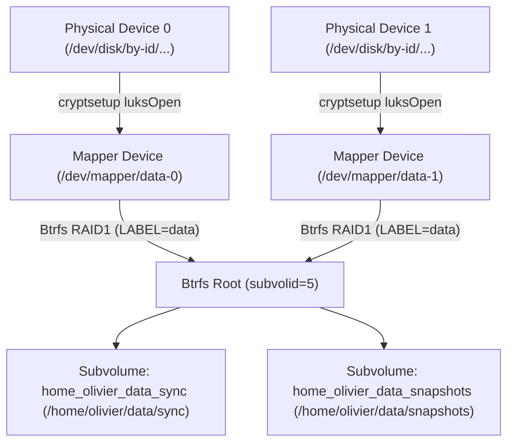

# 🚑 Disaster Recovery & Storage Operations Guide

This guide provides step-by-step procedures for emergency recovery, data restoration, LUKS header restoration, and hardware replacement for systems managed by the `homecode` infrastructure.

---

## 🏗️ Storage Stack Summary

Each encrypted server (`debian.delarche.fr`, `kodlix.delarche.fr`, `zotac.delarche.fr`) uses the following layered stack:



- **Passphrase**: Encrypted in Ansible Vault as `luks_pass`.
- **LUKS Header Backup**: Saved locally at `/var/backups/luks/luks-header-<name>-<idx>.img` (permissions `0400`).
- **Filesystem Label**: Matches the storage volume name (e.g. `data`), mounted via `LABEL=data`.

---

## 🚨 Scenario 1: Emergency Manual Unlock Without Ansible

If Ansible is unavailable, or if booting into a Debian Live USB or rescue environment:

### 1. Identify the block device
```bash
ls -l /dev/disk/by-id/
```

### 2. Decrypt and open the LUKS containers
For each physical disk in the pool:
```bash
sudo cryptsetup luksOpen /dev/disk/by-id/<disk-1-id> data-0
sudo cryptsetup luksOpen /dev/disk/by-id/<disk-2-id> data-1  # If RAID1 pool
```
*(Enter the `luks_pass` passphrase when prompted).*

Scan opened member devices into the kernel Btrfs pool:
```bash
sudo btrfs device scan
```

### 3. Mount the Btrfs subvolumes
Mount by label (`LABEL=data`) so Btrfs automatically mounts the complete pool (internal subvolume names flatten the absolute mount path with underscores):
```bash
sudo mkdir -p /mnt/recovery/data/sync /mnt/recovery/data/snapshots

# Mount the sync working tree
sudo mount -t btrfs -o subvol=home_olivier_data_sync,compress=zstd:1,noatime LABEL=data /mnt/recovery/data/sync

# Mount the snapshots tree
sudo mount -t btrfs -o subvol=home_olivier_data_snapshots,compress=zstd:1,noatime LABEL=data /mnt/recovery/data/snapshots
```

### 4. Unmount and close after operations
```bash
sudo umount /mnt/recovery/data/sync
sudo umount /mnt/recovery/data/snapshots
sudo cryptsetup luksClose data-0
sudo cryptsetup luksClose data-1  # If RAID1 pool
```

---

## 🔄 Scenario 2: Restoring Files from Btrfs Snapshots

Snapshots are stored as read-only Btrfs subvolumes under `~/data/snapshots/` in the format `YYYY-MM-DD--HH-MM-SS`.

### 1. List available snapshots
```bash
ls -lt ~/data/snapshots/
```

### 2. Restore an individual file or directory
Because snapshots are regular read-only directory trees, you can copy or `rsync` files directly back to `~/data/sync/`:

```bash
# Example: restoring a deleted directory
rsync -aHAXv ~/data/snapshots/2026-09-24--09-06-44/path/to/folder/ ~/data/sync/path/to/folder/
```

### 3. Trigger a manual snapshot
You can trigger an ad-hoc snapshot at any time via the systemd service (or the CLI script):

```bash
sudo systemctl start btrfs-snapshot-data.service
```
Or directly with custom retention (e.g. 14 daily, 8 weekly):
```bash
sudo "$HOME/bin/snapshot.sh" "$HOME/data/sync" "$HOME/data/snapshots" 14 8
```

---

## 🛡️ Scenario 3: Corrupted LUKS Header Recovery

The LUKS on-disk header contains the cipher parameters, salt, and keyslots. If bad sectors develop or the header is accidentally overwritten, data cannot be decrypted even with the correct passphrase.

The `crypto` role automatically maintains a header backup for each member device at `/var/backups/luks/luks-header-<name>-<idx>.img`.

### 1. Verify header corruption
```bash
sudo cryptsetup luksDump /dev/disk/by-id/<disk-id>
```
If this returns `Device is not a valid LUKS device`, the header is corrupted.

### 2. Restore the header from backup
```bash
sudo cryptsetup luksHeaderRestore /dev/disk/by-id/<disk-id> \
  --header-backup-file /var/backups/luks/luks-header-<name>-<idx>.img
```
Type `YES` in uppercase when prompted to confirm restoration.

### 3. Verify access
```bash
sudo cryptsetup luksOpen /dev/disk/by-id/<disk-id> <name>-<idx>
```

---

## 🖴 Scenario 4: Physical Disk Replacement

When replacing a failed hard drive or SSD:

### Case A: Replacing a member disk in a Btrfs RAID1 Pool (Online, Zero Data Loss)

If the storage pool uses Btrfs RAID1 mirroring across multiple disks, data is safely mirrored on the surviving members:

1. **Install the new physical disk and retrieve its persistent ID**:
   ```bash
   ls -l /dev/disk/by-id/
   ```

2. **Update host variables**:
   Edit `ansible/envs/<env>/host_vars/<hostname>/main.yml` and replace the failed disk ID with the new disk ID under `crypto_disks`:
   ```yaml
   crypto_disks:
     - name: data
       devices:
         - /dev/disk/by-id/ata-Samsung_SSD_870_EVO_<surviving_disk>
         - /dev/disk/by-id/ata-Samsung_SSD_870_EVO_<new_replacement_disk>
       subvolumes:
         - "/home/{{ ansible_user }}/data/sync"
         - "/home/{{ ansible_user }}/data/snapshots"
   ```

3. **Run the guided replacement playbook**:
   ```bash
   uv run ansible-playbook -i ansible/envs/<env>/inventory.ini ansible/storage-replace.yml
   ```
   This automated workflow:
   - Detects the unformatted replacement disk in `crypto_disks` (or targets a specific pool/member via `-e replace_pool=<pool> -e replace_index=<idx>`).
   - Prompts for explicit confirmation before proceeding.
   - Formats LUKS on the new disk with `luks_pass` and opens `/dev/mapper/<pool>-<idx>`.
   - Mounts the filesystem degraded if a missing drive prevented standard mounting.
   - Triggers `btrfs replace start` to stream mirrored data from surviving disks into the new disk.
   - Saves a new LUKS header backup to `/var/backups/luks/` and remounts all subvolumes cleanly.

4. **Verify replacement status**:
   ```bash
   sudo btrfs replace status /home/olivier/data/sync
   uv run ansible-playbook -i ansible/envs/<env>/inventory.ini ansible/status.yml --tags crypto
   ```

---

### Case B: Complete Storage Reset or Single-Disk Replacement (Destructive)

When replacing all disks simultaneously or resetting an entire pool from scratch:

1. **Update host variables** with all new device IDs in `ansible/envs/<env>/host_vars/<hostname>/main.yml`.

2. **Run the reset playbook**:
   ```bash
   uv run ansible-playbook -i ansible/envs/<env>/inventory.ini ansible/storage-wipe-and-reset.yml
   ```
   *(Prompts for explicit `WIPE` confirmation).*

3. **Deploy backup jobs**:
   ```bash
   uv run ansible-playbook -i ansible/envs/<env>/inventory.ini ansible/backup.yml
   ```

4. **Trigger initial cloud sync**:
   ```bash
   sudo systemctl start rclone-sync-onedrive-share-50ans.service
   sudo systemctl start rclone-sync-s3-delarche-images.service
   ```

---

## 🩺 Scenario 5: Routine Integrity Verification (Btrfs Scrub)

A monthly scrub cron job is automatically configured. To manually run and check data integrity against bit rot:

```bash
# Start scrub in foreground with progress
sudo btrfs scrub start -B ~/data/sync

# Check last scrub status and error counters
sudo btrfs scrub status ~/data/sync
```
Verify that `csum_errors`, `verify_errors`, and `uncorrectable_errors` report `0`.
