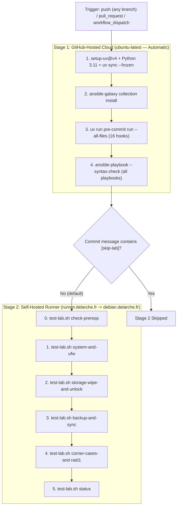

# GitHub Actions CI/CD & Self-Hosted Runner Setup Guide

This guide explains the two-stage GitHub Actions pipeline in [`.github/workflows/ci.yml`](../.github/workflows/ci.yml) and provides step-by-step instructions to provision the dedicated runner VM (`runner.delarche.fr`) with Ansible.

---

## 🏗️ Pipeline Architecture & Security Model

The CI pipeline runs a two-stage validation on every commit across all branches. Since the repository is **private** and the self-hosted runner is an **on-prem machine** owned by the repository owner, both stages run automatically without manual approval gates.



1. **Stage 1 — `lint-and-syntax` (`runs-on: ubuntu-latest`)**:
   - Runs **automatically** on every `push` (any branch), every `pull_request`, and on manual `workflow_dispatch`.
   - Executes in an ephemeral, unprivileged GitHub-hosted cloud VM with **zero secrets**.
   - Creates a temporary placeholder `~/.ansible_vault_pass` (`0600`) so `ansible.cfg` (`vault_password_file = ~/.ansible_vault_pass`) satisfies static analysis without exposing the real Vault password.
   - Runs all 16 `pre-commit` hooks (`ansible-lint --strict`, `yamllint --strict`, `shellcheck --severity=style`, `check-ansible-vault`, etc.) and validates the syntax of every playbook in `ansible/*.yml`.
2. **Stage 2 — `integration-tests-local` (`runs-on: self-hosted`)**:
   - Runs **automatically** after Stage 1 passes, unless the commit message contains `[skip-lab]`.
   - If a new commit arrives while a test campaign is running on the same branch, the in-progress run is **cancelled** (`cancel-in-progress: true`) and replaced by the new one.
   - Executes [`scripts/test-lab.sh`](../scripts/test-lab.sh) on `runner.delarche.fr` against the lab VM (`debian.delarche.fr`):
     - `system-and-ufw`: `system.yml` idempotence (`changed=0`) and UFW firewall drift remediation (`TC-SYS-01`, `TC-FW-03`).
     - `storage-wipe-and-unlock`: Full LUKS2 + Btrfs RAID1 reset (`storage-wipe-and-reset.yml -e confirm_wipe=yes`) and `storage-unlock.yml` idempotence (`TC-STO-01..02`).
     - `backup-and-sync`: `backup.yml` idempotence (`changed=0`), live `OneDrive:/Share/50ans` sync (`rclone-sync-onedrive-share-50ans.service` and multi-destination `rclone-sync-onedrive-share-50ans-backup.service`, verifying all 8 photos), live Btrfs snapshot creation (`btrfs-snapshot-data.service` and `btrfs-snapshot-backup.service`), negative validation test suite, and automatic orphan unit purge (`TC-BAK-01..07`).
     - `corner-cases-and-raid1`: Unmounted 0ms refusal (`TC-ADV-01`), kernel mount-namespace EROFS sandbox probe (`TC-ADV-03`), LUKS2 header corruption & restore (`TC-ADV-06`), and simulated disk wipe + auto-detected RAID1 rebuild + scrub (`TC-ADV-05` / `TC-STO-04`).
     - `status`: Complete read-only diagnostic report (`status.yml` / `TC-BAK-04`).

> [!TIP]
> **Skipping lab tests**: To push a commit without triggering the destructive lab campaign (e.g., documentation-only changes), include `[skip-lab]` anywhere in the commit message:
> ```bash
> git commit -m "docs: update README [skip-lab]"
> ```

---

## 🖥️ Step 1 — Provision & Register the Local Runner

You can run the self-hosted runner either on the dedicated **`runner.delarche.fr`** Debian VM managed by Ansible (**Option A**, recommended) or inside a rootless Podman container (**Option B**).

### Option A — Dedicated Debian VM (`runner.delarche.fr`) via Ansible (`systemd` Service)

`runner.delarche.fr` is declared in [`ansible/envs/live/inventory.ini`](../ansible/envs/live/inventory.ini) under the `[runner]` group and managed by the [`runner`](../ansible/roles/runner) role in [`ansible/system.yml`](../ansible/system.yml).

#### 1. Bootstrap & Provision `runner.delarche.fr` from Your Mac Controller

On a fresh Debian install on `runner.delarche.fr`:

```bash
# 1. Copy your SSH public key to runner.delarche.fr (once)
ssh-copy-id olivier@runner.delarche.fr

# 2. Run Day-0 bootstrap (configures passwordless sudo, SSH hardening, UFW, ~/.ansible_vault_pass, rclone.conf,
#    generates ~/.ssh/id_ed25519 on runner.delarche.fr, authorizes it on debian.delarche.fr, and installs the GitHub Actions runner binary)
uv run ansible-playbook -i ansible/envs/live/inventory.ini ansible/bootstrap.yml --limit runner.delarche.fr -K
```

Whenever you want to update OS packages, system configuration, `~/.ansible_vault_pass`, `~/.config/rclone/rclone.conf`, or upgrade the GitHub Actions Runner binary on `runner.delarche.fr` to the latest upstream release:

```bash
uv run ansible-playbook -i ansible/envs/live/inventory.ini ansible/system.yml --limit runner.delarche.fr
```

> [!TIP]
> The `runner` role automatically:
> - Copies your local `~/.ansible_vault_pass` (`0600`) and `~/.config/rclone/rclone.conf` (`0600`) to `runner.delarche.fr`.
> - Generates a dedicated Ed25519 keypair (`/home/olivier/.ssh/id_ed25519`) on `runner.delarche.fr`, adds `debian.delarche.fr` to `/home/olivier/.ssh/known_hosts`, and authorizes the runner's public key in `/home/olivier/.ssh/authorized_keys` on `debian.delarche.fr` (`exclusive: false`, so your Mac's keys and the runner's key coexist without overwriting each other, while `live` hosts only trust your Mac's keys).
> - Queries `https://api.github.com/repos/actions/runner/releases/latest`, stops `actions.runner.*.service` if an update is available, extracts the new release into `/opt/actions-runner`, and restarts the service.

> [!NOTE]
> **Secrets management**: All secrets (`~/.ansible_vault_pass` and `~/.config/rclone/rclone.conf`) are pre-provisioned directly on the on-prem runner by the `runner` Ansible role. No GitHub Secrets are used. The secrets persist on the runner by design since it is an on-prem machine owned and operated by the repository owner.

#### 2. Register the Runner with GitHub (One-Time Interactive Step)

1. In your GitHub repository, go to **Settings** $\rightarrow$ **Code, planning, and automation** $\rightarrow$ **Actions** $\rightarrow$ **Runners** and click **New self-hosted runner**.
2. Select **Linux** and **x64** (or **ARM64**), and copy the registration `--token` shown under the **Configure** section.
3. On `runner.delarche.fr`, register the runner and enable its `systemd` service:

```bash
cd /opt/actions-runner

# Register the runner with your repository
./config.sh \
  --url https://github.com/desnoe/homecode \
  --token <YOUR_REGISTRATION_TOKEN> \
  --name runner.delarche.fr \
  --labels self-hosted,linux,lab \
  --unattended

# Install and start the native systemd service running as user 'olivier'
sudo ./svc.sh install olivier
sudo ./svc.sh start
```

4. Verify the runner health from your Mac controller via `status.yml`:

```bash
uv run ansible-playbook -i ansible/envs/live/inventory.ini ansible/status.yml --limit runner.delarche.fr --tags runner
```

---

### Option B — Rootless Podman Container (Alternative)

If you prefer to run the GitHub Actions runner inside a rootless Podman container instead of a native `systemd` service:

1. Enable the rootless Podman socket for your user on the runner host:
   ```bash
   systemctl --user enable --now podman.socket
   loginctl enable-linger "$USER"
   export DOCKER_HOST="unix://${XDG_RUNTIME_DIR}/podman/podman.sock"
   ```
2. Launch the runner container mounting your read-only SSH key, `.ansible_vault_pass`, and `rclone.conf`:
   ```bash
   podman run -d \
     --name github-runner \
     --restart always \
     --network host \
     -e REPO_URL="https://github.com/desnoe/homecode" \
     -e RUNNER_NAME="podman-runner" \
     -e RUNNER_TOKEN="<YOUR_REGISTRATION_TOKEN>" \
     -e LABELS="self-hosted,linux,lab" \
     -v "${HOME}/.ssh:/home/runner/.ssh:ro,Z" \
     -v "${HOME}/.ansible_vault_pass:/home/runner/.ansible_vault_pass:ro,Z" \
     -v "${HOME}/.config/rclone:/home/runner/.config/rclone:Z" \
     docker.io/myoung34/github-runner:latest
   ```

---

## 🔄 Step 2 — Daily Workflow

1. **Every `git push` or Pull Request (Automatic — Full Pipeline)**:
   - Every push on any branch and every PR automatically runs both **Lint & Syntax Check (Cloud)** and **Full Lab Non-Regression Campaign (Self-Hosted)**.
   - If a new commit is pushed while a campaign is running on the same branch, the in-progress run is cancelled and replaced.
2. **Skipping lab tests**:
   - Include `[skip-lab]` in the commit message to skip the destructive lab campaign while still running lint and syntax checks.
3. **Manual re-run via GitHub UI**:
   - Open **Actions** $\rightarrow$ **CI** $\rightarrow$ **Run workflow** to manually trigger the full pipeline on any branch.

> [!TIP]
> You can also run [`scripts/test-lab.sh`](../scripts/test-lab.sh) directly from your terminal on your Mac or on `runner.delarche.fr` at any time:
> ```bash
> # Run a single stage
> ./scripts/test-lab.sh check-prereqs
> ./scripts/test-lab.sh backup-and-sync
>
> # Or run the entire lab non-regression campaign end-to-end
> ./scripts/test-lab.sh all
> ```

---

## 💰 Step 3 — GitHub Free Tier Quotas & Billing Rules

| Runner Type | Public Repository (`GitHub Free`) | Private Repository (`GitHub Free`) | Where Jobs Run |
| :--- | :--- | :--- | :--- |
| **GitHub-Hosted (`ubuntu-latest`)** *(Stage 1: `lint-and-syntax`)* | **100% Free & Unlimited** | **2,000 minutes / month included** *(~1,500–2,000 Stage 1 runs/month with `uv` cache)* | Microsoft Azure Cloud |
| **Self-Hosted (`self-hosted`)** *(Stage 2: `integration-tests-local`)* | **100% Free & Unlimited** | **100% Free & Unlimited** *(0 minutes deducted from your cloud quota)* | Your local VM (`runner.delarche.fr`) |

- **Zero Surprise Charges**: By default on a GitHub Free account, your spending limit for Actions is set to **$\$0.00$**. Even on a private repository, if you ever reached the 2,000 cloud minutes in a month, GitHub simply pauses cloud jobs until the next billing cycle without charging a cent, and **self-hosted runner jobs never consume any GitHub Actions minutes**.
