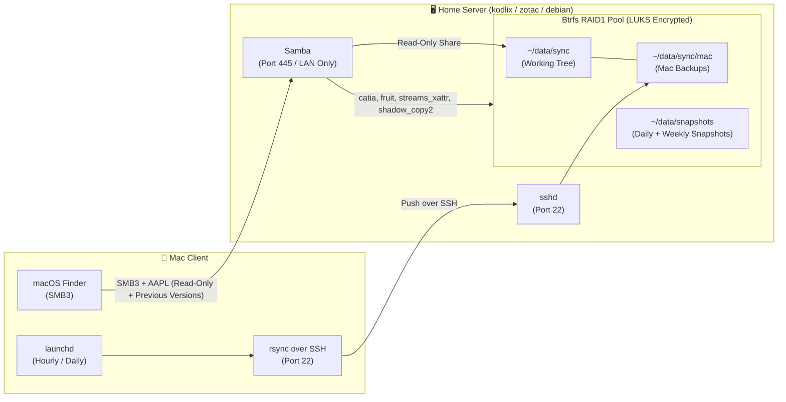

# 🍎 macOS User Guide: File Sharing, Snapshots & Remote Backup

This guide explains how to connect your Mac to the home servers (`kodlix.delarche.fr`, `zotac.delarche.fr`, `debian.delarche.fr`) to:
1. Browse shared data and access historical Btrfs snapshots natively using macOS Finder.
2. Back up local folders from your Mac to the server via automated `rsync` over SSH.

---

## 📌 Architecture Overview



---

## 📂 1. Connecting via macOS Finder (SMB3)

The servers expose the `/home/olivier/data/sync` directory as a secure, read-only SMB3 network share named `data`.

### Connection Steps

1. In macOS Finder, press **`Cmd + K`** (or go to **Go** $\rightarrow$ **Connect to Server...**).
2. Enter the server address:
   - Live working tree: `smb://zotac.delarche.fr/data` (or `kodlix.delarche.fr/data`)
   - Snapshot history: `smb://zotac.delarche.fr/data-snapshots` (or `kodlix.delarche.fr/data-snapshots`)
   - Backup working tree: `smb://zotac.delarche.fr/backup`
   - Backup snapshot history: `smb://zotac.delarche.fr/backup-snapshots`
3. Click **Connect**.
4. When prompted for credentials, select **Registered User**:
   - **Name**: `olivier`
   - **Password**: Your Samba password (stored encrypted as `samba_pass` in `ansible/envs/live/host_vars/<host>/vault.yml`).
5. (Optional) Check **"Remember this password in my keychain"** for seamless reconnection.

> [!IMPORTANT]
> **LAN Access Only**: SMB (port `445/tcp`) is restricted by the UFW firewall to the local home network (`192.168.1.0/24`). Connections from outside the local network or untrusted subnets are dropped automatically.

> [!NOTE]
> **Read-Only Share**: The SMB share is strictly read-only (`read only = yes`). This prevents accidental deletions, ransomware encryption, or modifications from client workstations. All data writes to the server must be performed via `rsync` over SSH.

### 🍎 Apple SMB (AAPL) VFS Extensions & Share Options

Samba shares are configured with native Apple SMB protocol extensions using a strict VFS object order:
```ini
vfs objects = catia fruit streams_xattr shadow_copy2
fruit:aapl = yes
fruit:encoding = native
fruit:metadata = stream
fruit:model = Macmini
```

- **`catia`**: Translates characters reserved by macOS/Windows (such as `:`, `?`, `*`) into valid POSIX filenames.
- **`fruit`**: Implements Apple AAPL extensions:
  - `fruit:aapl = yes`: Activates SMB2+ AAPL create contexts and high-performance directory caching.
  - `fruit:encoding = native`: Ensures filenames remain in UTF-8 NFC on the Linux filesystem without destructive mangling.
  - `fruit:metadata = stream`: Redirects macOS resource forks and Finder attributes into filesystem alternate data streams (`streams_xattr`) rather than polluting directories with AppleDouble `._*` sidecar files.
  - `fruit:model = Macmini`: Displays the native Apple hardware icon in the macOS Finder sidebar and network browser.
- **`streams_xattr`**: Stores Apple alternate streams and NTFS metadata in Linux extended attributes (`user.*` xattrs).
- **`shadow_copy2`**: Exposes server-side Btrfs snapshots as native macOS/Windows "Previous Versions".

#### Declarative Share Configuration Schema (`samba_shares`)

Each share entry in `host_vars/<host>/main.yml` supports:
- `name` *(required)*: Identifier of the share exposed on the network (e.g., `data`, `backup`).
- `path` *(required)*: Absolute directory path on the server (e.g., `/home/olivier/data/sync`).
- `snapdir` *(required)*: Absolute path to snapshot storage (e.g., `/home/olivier/data/snapshots`).
- `comment` *(optional)*: Share description (default: `Btrfs share with Previous Versions`).
- `read_only` *(optional, bool)*: Enforces read-only access (default: `true`).
- `browseable` *(optional, bool)*: Controls visibility in network browsing (default: `true`).
- `guest_ok` *(optional, bool)*: Permits unauthenticated guests (default: `false`).
- `valid_users` *(optional, string)*: Authorized login usernames (default: `{{ ansible_user }}`).
- `fruit` *(optional, bool)*: Enables Apple VFS extensions (default: `true`).
- `fruit_model` *(optional, string)*: Hardware icon displayed in Finder (default: `Macmini`, e.g., `MacBookPro`, `iMac`, `TimeCapsule`).

---

## 🕒 2. Browsing & Restoring Snapshots (macOS Finder vs. Windows)

The Samba server integrates Btrfs snapshots via the `vfs_shadow_copy2` module. However, macOS and Windows handle this protocol differently:

### ⚠️ The macOS Finder Limitation
> [!IMPORTANT]
> **No Native "Previous Versions" Menu in macOS Finder**:
> The "Previous Versions" (*Versions précédentes*) contextual menu is a **Windows Explorer-only feature** based on the Microsoft Remote Shadow Copy protocol (`FSCTL_SRV_ENUM_SNAPS`).
> **Apple has never implemented this Windows Shadow Copy GUI inside macOS Finder**. Therefore, when right-clicking a file in Finder on a Mac, you will **not** find a "Show Previous Versions" option.

### 🍏 How to Browse Snapshots on macOS

Since macOS Finder does not expose Shadow Copies natively in its contextual menu, snapshots can be browsed in two ways:

1. **Dedicated Read-Only Snapshot Shares (Recommended for Finder)**:
   Exposing snapshot directories as dedicated read-only Samba shares (e.g. `smb://<server>/data-snapshots` or `smb://<server>/backup-snapshots`).
   When connecting to this share in Finder via **Cmd + K**, you see each point-in-time snapshot as a standard read-only folder:
   - `2026-10-04--05-00-07/`
   - `2026-10-05--05-00-07/`
   - `2026-10-06--05-00-07/`
   You can open any dated folder, navigate the exact historical directory tree, and drag-and-drop older files directly back to your Mac.

2. **Via SSH or SFTP (Cyberduck / FileZilla / Terminal)**:
   Connect over SFTP to browse `/home/olivier/data/snapshots` and `/home/olivier/backup/snapshots` directly.

### 🪟 How to Browse Snapshots on Windows Clients
On a Windows workstation connected to `\\<server>\data`:
1. Right-click any file or folder and select **Properties**.
2. Switch to the **Previous Versions** (*Versions précédentes*) tab.
3. Windows Explorer queries Samba's `vfs_shadow_copy2` module and displays the historical timeline.
4. Select a timestamp and click **Open** or **Restore**.

---

## 🔄 3. Automated Mac Backup to Server (`rsync` over SSH)

Your Mac can automatically sync any local directories (Documents, Code, Photos, etc.) to the server target directory:
```text
/home/olivier/data/sync/mac/
```
Data copied to this directory automatically:
- Becomes visible in macOS Finder under `data/mac/`.
- Is protected by the server's Btrfs RAID1 mirroring.
- Is automatically versioned by the server's daily and ISO-weekly snapshot automation (`btrfs-snapshot-data.service`).

---

### Step A: Prerequisites & SSH Key Authentication

Ensure passwordless SSH key authentication is configured from your Mac to the server:

```bash
# Test passwordless SSH access
ssh olivier@kodlix.delarche.fr "echo SSH_CONNECTION_OK"
```

If needed, copy your Mac's SSH public key to the server using Ansible (`sshd` role automatically authorizes all keys found in your controller's `~/.ssh/*.pub`).

---

### Step B: Manual `rsync` Sync Command

To perform an on-demand sync from your Mac terminal:

```bash
rsync -avzP --delete \
    --exclude '.DS_Store' \
    --exclude '.Trash' \
    --exclude 'node_modules/' \
    ~/Documents/ \
    olivier@kodlix.delarche.fr:/home/olivier/data/sync/mac/Documents/
```

Key `rsync` flags:
- `-a` (`--archive`): Preserves permissions, ownership, symlinks, and timestamps.
- `-v` (`--verbose`): Detailed transfer progress.
- `-z` (`--compress`): Compresses data in transit across the network.
- `-P`: Shows progress bar and allows resuming interrupted transfers.
- `--delete`: Deletes remote files that no longer exist locally (keeps exact mirror).

---

### Step C: Automated Backup Script (`~/bin/backup-mac.sh`)

Create a local backup script on your Mac at `~/bin/backup-mac.sh`:

```bash
mkdir -p ~/bin
cat << 'EOF' > ~/bin/backup-mac.sh
#!/usr/bin/env bash
# Automated Mac to home server backup script via rsync/SSH
set -euo pipefail

readonly SERVER="kodlix.delarche.fr"
readonly REMOTE_USER="olivier"
readonly REMOTE_BASE="/home/olivier/data/sync/mac"

# Exit cleanly if server is unreachable (e.g., Mac is on a mobile network away from home)
if ! nc -z -G 2 "${SERVER}" 22 2>/dev/null; then
    echo "Server ${SERVER}:22 unreachable. Skipping backup."
    exit 0
fi

echo "Starting backup to ${REMOTE_USER}@${SERVER}:${REMOTE_BASE} at $(date)..."

# Sync Documents
rsync -a --delete \
    --exclude '.DS_Store' \
    --exclude '.Trash' \
    "${HOME}/Documents/" \
    "${REMOTE_USER}@${SERVER}:${REMOTE_BASE}/Documents/"

# Sync Pictures (optional)
# rsync -a --delete \
#     --exclude '.DS_Store' \
#     "${HOME}/Pictures/" \
#     "${REMOTE_USER}@${SERVER}:${REMOTE_BASE}/Pictures/"

echo "Backup completed successfully at $(date)."
EOF

chmod +x ~/bin/backup-mac.sh
```

Test running it manually:
```bash
~/bin/backup-mac.sh
```

---

### Step D: Scheduled Automation via `launchd`

macOS uses `launchd` instead of `cron` to schedule background jobs. This ensures backups trigger reliably even after the Mac sleeps and wakes up.

1. Create a LaunchAgent property list at `~/Library/LaunchAgents/fr.delarche.mac-backup.plist`:

```xml
<?xml version="1.0" encoding="UTF-8"?>
<!DOCTYPE plist PUBLIC "-//Apple//DTD PLIST 1.0//EN" "http://www.apple.com/DTDs/PropertyList-1.0.dtd">
<plist version="1.0">
<dict>
    <key>Label</key>
    <string>fr.delarche.mac-backup</string>

    <key>ProgramArguments</key>
    <array>
        <string>/bin/bash</string>
        <string>-c</string>
        <string>$HOME/bin/backup-mac.sh</string>
    </array>

    <!-- Run every hour (3600 seconds) -->
    <key>StartInterval</key>
    <integer>3600</integer>

    <!-- Standard log files -->
    <key>StandardOutPath</key>
    <string>/tmp/mac-backup.log</string>
    <key>StandardErrorPath</key>
    <string>/tmp/mac-backup.err</string>

    <!-- Run immediately upon load if scheduled run was missed during sleep -->
    <key>RunAtLoad</key>
    <true/>
</dict>
</plist>
```

2. Load the LaunchAgent:
```bash
launchctl load ~/Library/LaunchAgents/fr.delarche.mac-backup.plist
```

3. Manage the LaunchAgent:
```bash
# Check status
launchctl list | grep fr.delarche.mac-backup

# View recent log output
cat /tmp/mac-backup.log

# Trigger an immediate run
launchctl start fr.delarche.mac-backup

# Stop / unload the agent
launchctl unload ~/Library/LaunchAgents/fr.delarche.mac-backup.plist
```

---

## ❓ Frequently Asked Questions & Troubleshooting

### 1. Finder displays "Connection failed" or times out
- **Check network**: Ensure your Mac is connected to the local Wi-Fi or wired network (`192.168.1.0/24`). UFW will drop connections from other subnets.
- **Check server status**: Ensure the server is online and unlocked:
  ```bash
  ssh olivier@kodlix.delarche.fr "systemctl status smbd"
  ```
- **Check LUKS storage**: If the server was recently rebooted, storage must be unlocked first:
  ```bash
  uv run ansible-playbook -i ansible/envs/live/inventory.ini ansible/storage-unlock.yml
  ```

### 2. "Authentication Failed" when connecting from Finder
- Ensure you are logging in with user `olivier` (not your local Mac username if it differs).
- Verify the password in the encrypted vault file:
  ```bash
  uv run ansible-vault view ansible/envs/live/host_vars/kodlix.delarche.fr/vault.yml
  ```

### 3. Finder displays "Permission Denied" when trying to copy a file to the share
- **Expected behavior**: The Samba share is intentionally read-only.
- To upload files, use `rsync` over SSH into `~/data/sync/mac/` as described in Section 3.

### 4. "Show Previous Versions" is empty or missing
- Snapshots are created daily at `05:00` by `btrfs-snapshot-data.service`. Ensure at least one snapshot exists:
  ```bash
  ssh olivier@kodlix.delarche.fr "ls -l ~/data/snapshots"
  ```
- Trigger an immediate snapshot on the server if needed:
  ```bash
  ssh olivier@kodlix.delarche.fr "sudo systemctl start btrfs-snapshot-data.service"
  ```
