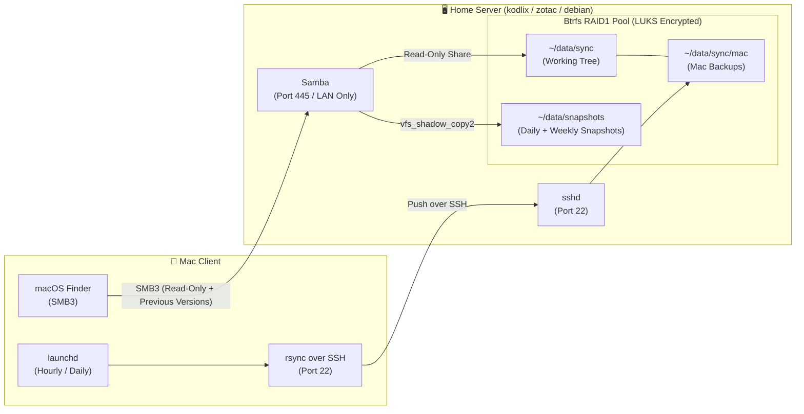

# 🍎 macOS User Guide: File Sharing, Snapshots & Remote Backup

This guide explains how to connect your Mac to the home servers (`kodlix.delarche.fr`, `zotac.delarche.fr`, `debian.delarche.fr`) to:
1. Browse shared data and access historical Btrfs snapshots natively using macOS Finder.
2. Back up local folders from your Mac to the server via automated `rsync` over SSH.

---

## 📌 Architecture Overview



---

## 📂 1. Connecting via macOS Finder (SMB3)

The servers expose the `/home/olivier/data/sync` directory as a secure, read-only SMB3 network share named `data`.

### Connection Steps

1. In macOS Finder, press **`Cmd + K`** (or go to **Go** $\rightarrow$ **Connect to Server...**).
2. Enter the server address:
   ```text
   smb://kodlix.delarche.fr/data
   ```
   *(or `smb://zotac.delarche.fr/data` / `smb://debian.delarche.fr/data` for lab).*
3. Click **Connect**.
4. When prompted for credentials, select **Registered User**:
   - **Name**: `olivier`
   - **Password**: Your Samba password (stored encrypted as `samba_pass` in `ansible/envs/live/host_vars/<host>/vault.yml`).
5. (Optional) Check **"Remember this password in my keychain"** for seamless reconnection.

> [!IMPORTANT]
> **LAN Access Only**: SMB (port `445/tcp`) is restricted by the UFW firewall to the local home network (`192.168.1.0/24`). Connections from outside the local network or untrusted subnets are dropped automatically.

> [!NOTE]
> **Read-Only Share**: The SMB share is strictly read-only (`read only = yes`). This prevents accidental deletions, ransomware encryption, or modifications from client workstations. All data writes to the server must be performed via `rsync` over SSH.

---

## 🕒 2. Browsing & Restoring Snapshots (Previous Versions)

Samba is integrated directly with Btrfs snapshots via the `vfs_shadow_copy2` module. Every daily and weekly snapshot taken by `snapshot.sh` on the server is exposed to macOS as a native "Previous Version".

### How to Browse Snapshots in Finder

1. Inside the mounted share in Finder, locate any file or folder.
2. **Right-click** (or Control-click) the file or folder.
3. Select **"Show Previous Versions"** (or **"Versions précédentes"** if your macOS language is French).
4. A native sheet displays the historical timeline of snapshots (dated `YYYY-MM-DD--HH-MM-SS`).
5. Double-click any snapshot version to view the exact state of that file or folder at that point in time.

### How to Restore a File

- **To recover a previous version**: Simply drag and drop or copy the file from the snapshot view to your local Mac disk (e.g., your Desktop or Documents folder).
- Because the share is read-only, you cannot overwrite files directly on the share from the snapshot window. Instead, copy the desired version to your Mac, make any needed edits, and sync it back to the server using `rsync`.

---

## 🔄 3. Automated Mac Backup to Server (`rsync` over SSH)

Your Mac can automatically sync any local directories (Documents, Code, Photos, etc.) to the server target directory:
```text
/home/olivier/data/sync/mac/
```
Data copied to this directory automatically:
- Becomes visible in macOS Finder under `data/mac/`.
- Is protected by the server's Btrfs RAID1 mirroring.
- Is automatically versioned by the server's daily and ISO-weekly snapshot automation (`btrfs-snapshot-data.service`).

---

### Step A: Prerequisites & SSH Key Authentication

Ensure passwordless SSH key authentication is configured from your Mac to the server:

```bash
# Test passwordless SSH access
ssh olivier@kodlix.delarche.fr "echo SSH_CONNECTION_OK"
```

If needed, copy your Mac's SSH public key to the server using Ansible (`sshd` role automatically authorizes all keys found in your controller's `~/.ssh/*.pub`).

---

### Step B: Manual `rsync` Sync Command

To perform an on-demand sync from your Mac terminal:

```bash
rsync -avzP --delete \
    --exclude '.DS_Store' \
    --exclude '.Trash' \
    --exclude 'node_modules/' \
    ~/Documents/ \
    olivier@kodlix.delarche.fr:/home/olivier/data/sync/mac/Documents/
```

Key `rsync` flags:
- `-a` (`--archive`): Preserves permissions, ownership, symlinks, and timestamps.
- `-v` (`--verbose`): Detailed transfer progress.
- `-z` (`--compress`): Compresses data in transit across the network.
- `-P`: Shows progress bar and allows resuming interrupted transfers.
- `--delete`: Deletes remote files that no longer exist locally (keeps exact mirror).

---

### Step C: Automated Backup Script (`~/bin/backup-mac.sh`)

Create a local backup script on your Mac at `~/bin/backup-mac.sh`:

```bash
mkdir -p ~/bin
cat << 'EOF' > ~/bin/backup-mac.sh
#!/usr/bin/env bash
# Automated Mac to home server backup script via rsync/SSH
set -euo pipefail

readonly SERVER="kodlix.delarche.fr"
readonly REMOTE_USER="olivier"
readonly REMOTE_BASE="/home/olivier/data/sync/mac"

# Exit cleanly if server is unreachable (e.g., Mac is on a mobile network away from home)
if ! nc -z -G 2 "${SERVER}" 22 2>/dev/null; then
    echo "Server ${SERVER}:22 unreachable. Skipping backup."
    exit 0
fi

echo "Starting backup to ${REMOTE_USER}@${SERVER}:${REMOTE_BASE} at $(date)..."

# Sync Documents
rsync -a --delete \
    --exclude '.DS_Store' \
    --exclude '.Trash' \
    "${HOME}/Documents/" \
    "${REMOTE_USER}@${SERVER}:${REMOTE_BASE}/Documents/"

# Sync Pictures (optional)
# rsync -a --delete \
#     --exclude '.DS_Store' \
#     "${HOME}/Pictures/" \
#     "${REMOTE_USER}@${SERVER}:${REMOTE_BASE}/Pictures/"

echo "Backup completed successfully at $(date)."
EOF

chmod +x ~/bin/backup-mac.sh
```

Test running it manually:
```bash
~/bin/backup-mac.sh
```

---

### Step D: Scheduled Automation via `launchd`

macOS uses `launchd` instead of `cron` to schedule background jobs. This ensures backups trigger reliably even after the Mac sleeps and wakes up.

1. Create a LaunchAgent property list at `~/Library/LaunchAgents/fr.delarche.mac-backup.plist`:

```xml
<?xml version="1.0" encoding="UTF-8"?>
<!DOCTYPE plist PUBLIC "-//Apple//DTD PLIST 1.0//EN" "http://www.apple.com/DTDs/PropertyList-1.0.dtd">
<plist version="1.0">
<dict>
    <key>Label</key>
    <string>fr.delarche.mac-backup</string>

    <key>ProgramArguments</key>
    <array>
        <string>/bin/bash</string>
        <string>-c</string>
        <string>$HOME/bin/backup-mac.sh</string>
    </array>

    <!-- Run every hour (3600 seconds) -->
    <key>StartInterval</key>
    <integer>3600</integer>

    <!-- Standard log files -->
    <key>StandardOutPath</key>
    <string>/tmp/mac-backup.log</string>
    <key>StandardErrorPath</key>
    <string>/tmp/mac-backup.err</string>

    <!-- Run immediately upon load if scheduled run was missed during sleep -->
    <key>RunAtLoad</key>
    <true/>
</dict>
</plist>
```

2. Load the LaunchAgent:
```bash
launchctl load ~/Library/LaunchAgents/fr.delarche.mac-backup.plist
```

3. Manage the LaunchAgent:
```bash
# Check status
launchctl list | grep fr.delarche.mac-backup

# View recent log output
cat /tmp/mac-backup.log

# Trigger an immediate run
launchctl start fr.delarche.mac-backup

# Stop / unload the agent
launchctl unload ~/Library/LaunchAgents/fr.delarche.mac-backup.plist
```

---

## ❓ Frequently Asked Questions & Troubleshooting

### 1. Finder displays "Connection failed" or times out
- **Check network**: Ensure your Mac is connected to the local Wi-Fi or wired network (`192.168.1.0/24`). UFW will drop connections from other subnets.
- **Check server status**: Ensure the server is online and unlocked:
  ```bash
  ssh olivier@kodlix.delarche.fr "systemctl status smbd"
  ```
- **Check LUKS storage**: If the server was recently rebooted, storage must be unlocked first:
  ```bash
  uv run ansible-playbook -i ansible/envs/live/inventory.ini ansible/storage-unlock.yml
  ```

### 2. "Authentication Failed" when connecting from Finder
- Ensure you are logging in with user `olivier` (not your local Mac username if it differs).
- Verify the password in the encrypted vault file:
  ```bash
  uv run ansible-vault view ansible/envs/live/host_vars/kodlix.delarche.fr/vault.yml
  ```

### 3. Finder displays "Permission Denied" when trying to copy a file to the share
- **Expected behavior**: The Samba share is intentionally read-only.
- To upload files, use `rsync` over SSH into `~/data/sync/mac/` as described in Section 3.

### 4. "Show Previous Versions" is empty or missing
- Snapshots are created daily at `05:00` by `btrfs-snapshot-data.service`. Ensure at least one snapshot exists:
  ```bash
  ssh olivier@kodlix.delarche.fr "ls -l ~/data/snapshots"
  ```
- Trigger an immediate snapshot on the server if needed:
  ```bash
  ssh olivier@kodlix.delarche.fr "sudo systemctl start btrfs-snapshot-data.service"
  ```
