# 🧪 Test Book & Non-Regression Verification Guide

This document centralizes all static, functional, security, and chaos/corner-case test procedures for the `homecode` repository. Every test case is formatted as an actionable Test Card with deterministic commands and pass criteria validated against the `lab` environment (`debian.delarche.fr`).

---

## 🗺️ Test Architecture & Domains Overview

```mermaid
flowchart LR
    QA["1. Static Quality Gates (TC-QA-01..02)"] --> SYS["2. System, Locales, NTP & SSHD (TC-SYS-01..04)"]
    SYS --> FW["3. UFW Dual-Stack Firewall (TC-FW-01..03)"]
    FW --> STO["4. LUKS & Btrfs RAID1 Storage (TC-STO-01..04)"]
    STO --> BAK["5. Systemd Rclone & Snapshots (TC-BAK-01..04)"]
    BAK --> ADV["6. Advanced Corner Cases & Chaos (TC-ADV-01..06)"]
    ADV --> RUN["7. Master Non-Regression Checklist"]
```



| Domain Prefix | Scope | Playbooks / Components Covered | Test Count |
| :--- | :--- | :--- | :--- |
| **`TC-QA`** | Static Quality Gates & Linting | `.pre-commit-config.yaml`, `.ansible-lint`, `.yamllint`, `shellcheck`, `vault.yml` | 2 |
| **`TC-SYS`** | System Baseline, Locales, Time & SSH | `bootstrap.yml`, `system.yml`, `apt`, `base`, `locales`, `ntp`, `sshd`, `sudo`, `vim`, `htop` | 4 |
| **`TC-FW`** | Dual-Stack Firewall (`ufw`) | `system.yml`, `ufw` role, `iptables` / `ip6tables` kernel chains | 3 |
| **`TC-STO`** | Encrypted Storage & Btrfs RAID1 | `storage-wipe-and-reset.yml`, `storage-unlock.yml`, `storage-replace.yml`, `crypto` role | 4 |
| **`TC-BAK`** | Cloud Sync & Btrfs Snapshots (`systemd`) | `backup.yml`, `status.yml`, `rclone` role, `snapshot` role | 4 |
| **`TC-ADV`** | Advanced Corner Cases & Chaos Sequences | Unmounted pool guards, live unmount kill-switch, kernel sandboxing, ISO-week pruning, header recovery | 6 |

---

## 1. Static Quality Gates & Linting (`TC-QA`)

### `TC-QA-01` — Full Pre-Commit Hook Suite
- **Objective**: Verify that all YAML, Ansible, Bash, and Vault files comply with strict production linting rules before any deployment.
- **Preconditions**: Local Python 3.11 `.venv` initialized via `uv sync` and Ansible collections installed in `ansible/collections/`.
- **Commands**:
  ```bash
  ANSIBLE_HOME=/tmp/.ansible uv run pre-commit run --all-files
  ```
- **Expected Result**:
  - Exit code `0`.
  - All 16 hooks report `Passed` (`ansible-lint --strict` with `profile: production`, `yamllint --strict`, `shellcheck --severity=style`, `check-ansible-vault`, and `pre-commit-hooks v5.0.0`).

---

### `TC-QA-02` — Playbook Syntax & Vault Encryption Verification
- **Objective**: Ensure all 7 operational playbooks parse cleanly across `lab` and `live` inventories and no `vault.yml` file is stored in plaintext.
- **Preconditions**: `~/.ansible_vault_pass` present (`mode 0600`).
- **Commands**:
  ```bash
  for pb in ansible/*.yml; do
    [ "$(basename "$pb")" = "requirements.yml" ] && continue
    ANSIBLE_HOME=/tmp/.ansible uv run ansible-playbook -i ansible/envs/lab/inventory.ini --syntax-check "$pb"
  done
  head -n 1 ansible/envs/*/host_vars/*/vault.yml
  ```
- **Expected Result**:
  - Every playbook prints `playbook: ansible/<name>.yml` with exit code `0`.
  - Every `vault.yml` header starts with `$ANSIBLE_VAULT;1.1;AES256`.

---

## 2. System Baseline, Locales, Time/NTP & SSHD (`TC-SYS`)

### `TC-SYS-01` — Day-0 Bootstrap & System Baseline Idempotence
- **Objective**: Verify that `system.yml` (and `bootstrap.yml` chaining `system.yml`) converges cleanly and achieves `changed=0` on the second execution.
- **Preconditions**: Lab VM (`debian.delarche.fr`) reachable over SSH.
- **Commands**:
  ```bash
  ANSIBLE_HOME=/tmp/.ansible uv run ansible-playbook -i ansible/envs/lab/inventory.ini ansible/system.yml
  ANSIBLE_HOME=/tmp/.ansible uv run ansible-playbook -i ansible/envs/lab/inventory.ini ansible/system.yml
  ```
- **Expected Result**:
  - Second run completes with `changed=0, unreachable=0, failed=0`.

---

### `TC-SYS-02` — Hybrid English UI / French Regional Units & French Keyboard
- **Objective**: Verify that the system UI and logs remain in English (`en_US.UTF-8`) while date, metric units, paper size, currency, and console keyboard use French standards (`fr_FR.UTF-8`, `fr`/`latin9`), and `/etc/default/locale` is a symlink to `/etc/locale.conf`.
- **Preconditions**: `system.yml` applied.
- **Commands**:
  ```bash
  ANSIBLE_HOME=/tmp/.ansible uv run ansible-playbook -i ansible/envs/lab/inventory.ini ansible/status.yml --tags locales
  ssh olivier@debian.delarche.fr "readlink -f /etc/default/locale && locale -a | grep -E 'en_US|fr_FR'"
  ```
- **Expected Result**:
  - `readlink -f /etc/default/locale` outputs `/etc/locale.conf`.
  - `LANG=en_US.UTF-8` and `LC_TIME=fr_FR.UTF-8`, `LC_MEASUREMENT=fr_FR.UTF-8`, `LC_PAPER=fr_FR.UTF-8`, `LC_MONETARY=fr_FR.UTF-8`.
  - `/etc/default/keyboard` contains `XKBLAYOUT="fr"` and `XKBVARIANT="latin9"`.

---

### `TC-SYS-03` — Timezone (`Europe/Paris`), Chrony NTP & Leap-Second Slew
- **Objective**: Confirm `Europe/Paris` timezone (automatic CET/CEST transitions), `fr.pool.ntp.org` synchronization, and monotonic leap-second slewing (`leapsecmode slew`).
- **Preconditions**: `system.yml` applied.
- **Commands**:
  ```bash
  ANSIBLE_HOME=/tmp/.ansible uv run ansible-playbook -i ansible/envs/lab/inventory.ini ansible/status.yml --tags ntp
  ssh olivier@debian.delarche.fr "grep -E '^(pool|leapseclist|leapsecmode)' /etc/chrony/chrony.conf"
  ```
- **Expected Result**:
  - `Time zone: Europe/Paris`, `System clock synchronized: yes`, `NTP service: active`.
  - `chronyc tracking` reports `Leap status : Normal`.
  - `/etc/chrony/chrony.conf` contains `pool fr.pool.ntp.org iburst`, `leapseclist /usr/share/zoneinfo/leap-seconds.list`, and `leapsecmode slew`.

---

### `TC-SYS-04` — SSHD Multi-Key Auto-Discovery & Authentication Hardening
- **Objective**: Verify that all local `~/.ssh/*.pub` keys (`id_ecdsa.pub`, `id_rsa.pub`, etc.) are deployed with `exclusive: true`, password/root login is disabled, and each key can authenticate independently.
- **Preconditions**: `system.yml` applied.
- **Commands**:
  ```bash
  ANSIBLE_HOME=/tmp/.ansible uv run ansible-playbook -i ansible/envs/lab/inventory.ini ansible/status.yml --tags sshd
  for key in ~/.ssh/*.pub; do
    priv="${key%.pub}"
    ssh -i "$priv" -o IdentitiesOnly=yes -o BatchMode=yes olivier@debian.delarche.fr "echo Auth OK with $(basename "$priv")"
  done
  ```
- **Expected Result**:
  - `sshd -T` reports `passwordauthentication no`, `permitrootlogin no`, `pubkeyauthentication yes`.
  - Every local key prints `Auth OK with <key_name>`.

---

## 3. Dual-Stack Firewall (`ufw`) 3-Step Non-Regression (`TC-FW`)

### `TC-FW-01` — Service & Dual-Stack Netfilter Kernel State
- **Objective**: Verify that `ufw` is active, enabled at boot, and enforces default-deny incoming filtering in both IPv4 (`iptables`) and IPv6 (`ip6tables`).
- **Preconditions**: `system.yml` applied.
- **Commands**:
  ```bash
  ANSIBLE_HOME=/tmp/.ansible uv run ansible-playbook -i ansible/envs/lab/inventory.ini ansible/status.yml --tags ufw
  ssh olivier@debian.delarche.fr "sudo systemctl is-enabled ufw && sudo iptables -S ufw-user-input && sudo ip6tables -S ufw6-user-input"
  ```
- **Expected Result**:
  - `Status: active`, `Default: deny (incoming), allow (outgoing), deny (routed)`.
  - `ufw-user-input` and `ufw6-user-input` contain `-p tcp --dport 22 -j ACCEPT` and no unauthorized ports.

---

### `TC-FW-02` — Live Positive & Negative Network Filtering Probe
- **Objective**: Prove with real network traffic that loopback traffic (`lo`) and SSH (`22/tcp`) are allowed while unauthorized external TCP ports (`9999/tcp`) are dropped.
- **Preconditions**: `ufw` active on `debian.delarche.fr`.
- **Commands**:
  ```bash
  # 1. Start ephemeral listener on port 9999 on target, test loopback, then test from controller
  ssh olivier@debian.delarche.fr "nohup python3 -m http.server 9999 --bind 0.0.0.0 >/dev/null 2>&1 & echo \$! > /tmp/http9999.pid; sleep 1; curl -fsS http://127.0.0.1:9999 >/dev/null && echo LOOPBACK_OK"
  ! nc -zv -G 2 debian.delarche.fr 9999 && echo EXTERNAL_9999_BLOCKED_OK
  nc -zv -G 2 debian.delarche.fr 22 && echo EXTERNAL_22_ALLOWED_OK
  ssh olivier@debian.delarche.fr "kill \$(cat /tmp/http9999.pid) 2>/dev/null || true; rm -f /tmp/http9999.pid"
  ```
- **Expected Result**:
  - `LOOPBACK_OK`, `EXTERNAL_9999_BLOCKED_OK` (`Operation timed out` / dropped), and `EXTERNAL_22_ALLOWED_OK`.

---

### `TC-FW-03` — Firewall Drift / Disable Remediation
- **Objective**: Verify that if `ufw` is manually disabled on a host, running `system.yml` detects the drift (`changed=1`) and re-enables the firewall automatically.
- **Preconditions**: `system.yml` applied.
- **Commands**:
  ```bash
  ssh olivier@debian.delarche.fr "sudo ufw disable"
  ANSIBLE_HOME=/tmp/.ansible uv run ansible-playbook -i ansible/envs/lab/inventory.ini ansible/system.yml
  ssh olivier@debian.delarche.fr "sudo ufw status verbose"
  ```
- **Expected Result**:
  - Task `ufw : Enable UFW firewall` reports `changed: [debian.delarche.fr]`.
  - `sudo ufw status verbose` returns `Status: active`.

---

## 4. Encrypted Storage (`crypto`) & Btrfs RAID1 Lifecycle (`TC-STO`)

### `TC-STO-01` — Destructive Wipe & Multi-Pool RAID1 Initialization
- **Objective**: Validate full LUKS formatting, header backup creation (`0400`), multi-device Btrfs RAID1 creation (`-d raid1 -m raid1`), and flattened subvolume mounting across all pools (`data` and `backup`).
- **Preconditions**: Lab VM with 4 virtual disks (`ata-debian-1..4`).
- **Commands**:
  ```bash
  ANSIBLE_HOME=/tmp/.ansible uv run ansible-playbook -i ansible/envs/lab/inventory.ini ansible/storage-wipe-and-reset.yml -e confirm_wipe=yes
  ANSIBLE_HOME=/tmp/.ansible uv run ansible-playbook -i ansible/envs/lab/inventory.ini ansible/status.yml --tags crypto
  ```
- **Expected Result**:
  - `/var/backups/luks/luks-header-{data,backup}-{0,1}.img` present with mode `0400`.
  - `btrfs filesystem df /home/olivier/data/sync` and `/home/olivier/backup` show `Data, RAID1` and `Metadata, RAID1`.
  - `/home/olivier/data/sync`, `/home/olivier/data/snapshots`, and `/home/olivier/backup` are mounted with `compress=zstd:3,noatime,user_subvol_rm_allowed`.

---

### `TC-STO-02` — Post-Reboot Unlock Idempotence
- **Objective**: Verify that running `storage-unlock.yml` when pools are already unlocked and mounted is 100% idempotent (`changed=0`).
- **Preconditions**: Pools unlocked and mounted.
- **Commands**:
  ```bash
  ANSIBLE_HOME=/tmp/.ansible uv run ansible-playbook -i ansible/envs/lab/inventory.ini ansible/storage-unlock.yml
  ```
- **Expected Result**:
  - `changed=0, unreachable=0, failed=0`.

---

### `TC-STO-03` — Simulated Reboot / Full Lock & Unlock Cycle
- **Objective**: Simulate a server reboot by unmounting all Btrfs subvolumes and closing all LUKS mappers, verify `status.yml` handles the locked state gracefully, and unlock via `storage-unlock.yml` with zero data loss.
- **Preconditions**: Pools unlocked and mounted.
- **Commands**:
  ```bash
  ssh olivier@debian.delarche.fr "echo 'REBOOT_SURVIVAL_TEST' > /home/olivier/data/sync/reboot_test.txt && sync && sudo umount /home/olivier/data/sync /home/olivier/data/snapshots /home/olivier/backup && sudo cryptsetup luksClose data-0 && sudo cryptsetup luksClose data-1 && sudo cryptsetup luksClose backup-0 && sudo cryptsetup luksClose backup-1"
  ANSIBLE_HOME=/tmp/.ansible uv run ansible-playbook -i ansible/envs/lab/inventory.ini ansible/status.yml --tags crypto
  ANSIBLE_HOME=/tmp/.ansible uv run ansible-playbook -i ansible/envs/lab/inventory.ini ansible/storage-unlock.yml
  ssh olivier@debian.delarche.fr "cat /home/olivier/data/sync/reboot_test.txt && rm -f /home/olivier/data/sync/reboot_test.txt"
  ```
- **Expected Result**:
  - Locked `status.yml` reports mappers as `LOCKED / CLOSED` without failing (`failed=0`).
  - `storage-unlock.yml` unlocks all 4 mappers, mounts all subvolumes, and `cat` outputs `REBOOT_SURVIVAL_TEST`.

---

### `TC-STO-04` — Online Targeted RAID1 Disk Replacement (`storage-replace.yml`)
- **Objective**: Test online replacement of a specific pool member (`-e replace_pool=<pool> -e replace_index=<idx>`) across `data` and `backup` pools without data loss.
- **Preconditions**: Pools unlocked and mounted.
- **Commands**:
  ```bash
  ANSIBLE_HOME=/tmp/.ansible uv run ansible-playbook -i ansible/envs/lab/inventory.ini ansible/storage-replace.yml -e replace_pool=data -e replace_index=1 -e confirm_replace=yes
  ANSIBLE_HOME=/tmp/.ansible uv run ansible-playbook -i ansible/envs/lab/inventory.ini ansible/status.yml --tags crypto
  ```
- **Expected Result**:
  - `btrfs replace status` reports `0 write errs, 0 uncorr. read errs`.
  - Both member devices (`devid 1` and `devid 2`) are active in `btrfs filesystem show` with `0` Btrfs device errors.

---

## 5. Cloud Sync (`rclone`) & Btrfs Snapshots (`snapshot`) via `systemd` (`TC-BAK`)

### `TC-BAK-01` — `backup.yml` Deployment, Official `rclone` Package & Idempotence
- **Objective**: Verify that `backup.yml` installs the current upstream `rclone` `.deb` package, copies `~/.config/rclone/rclone.conf` (`0600`, `no_log: true`), enables all `systemd` timers, and achieves `changed=0` on the second run.
- **Preconditions**: Pools unlocked and mounted; local `~/.config/rclone/rclone.conf` present.
- **Commands**:
  ```bash
  ANSIBLE_HOME=/tmp/.ansible uv run ansible-playbook -i ansible/envs/lab/inventory.ini ansible/backup.yml
  ANSIBLE_HOME=/tmp/.ansible uv run ansible-playbook -i ansible/envs/lab/inventory.ini ansible/backup.yml
  ```
- **Expected Result**:
  - Second run completes with `changed=0, failed=0`.
  - `rclone --version` on the remote host matches `https://downloads.rclone.org/version.txt` (`v1.75.1+`).
  - `/home/olivier/.config/rclone/rclone.conf` has mode `0600`.

---

### `TC-BAK-02` — Live `OneDrive:/Share/50ans` Cloud Synchronization
- **Objective**: Trigger `rclone-sync-onedrive-share-50ans.service` and verify that the 8 reference files from `OneDrive:/Share/50ans` are downloaded with exact byte sizes.
- **Preconditions**: `backup.yml` applied and `/home/olivier/data/sync` mounted.
- **Commands**:
  ```bash
  ssh olivier@debian.delarche.fr "sudo systemctl start rclone-sync-onedrive-share-50ans.service && rclone ls /home/olivier/data/sync/OneDrive/Share/50ans | sort -k2"
  ```
- **Expected Result**:
  ```text
    2967925 001_20092025_IMG_4422.jpg
    4308511 002_20092025_IMG_4431.jpg
    4674295 003_20092025_IMG_4436.jpg
    4671957 004_20092025_IMG_4438.jpg
    3986394 005_20092025_IMG_4445.jpg
   14961134 006_20092025__MGL9738.jpg
   16677274 007_20092025__MGL9740.jpg
   21642360 008_20092025__MGL9742.jpg
  ```

---

### `TC-BAK-03` — Live Read-Only Btrfs Snapshot Creation (`btrfs-snapshot-data.service`)
- **Objective**: Trigger `btrfs-snapshot-data.service` and verify that a read-only Btrfs subvolume snapshot (`YYYY-MM-DD--HH-MM-SS`) is created in `/home/olivier/data/snapshots/` containing the synced OneDrive files.
- **Preconditions**: `TC-BAK-02` completed.
- **Commands**:
  ```bash
  ssh olivier@debian.delarche.fr "sudo systemctl start btrfs-snapshot-data.service && SNAP=\$(ls -td /home/olivier/data/snapshots/20* | head -n 1) && sudo btrfs property get \"\$SNAP\" ro && rclone ls \"\$SNAP/OneDrive/Share/50ans\" | sort -k2"
  ```
- **Expected Result**:
  - `btrfs property get` outputs `ro=true`.
  - `rclone ls` inside the snapshot outputs the exact 8 files from `TC-BAK-02`.

---

### `TC-BAK-04` — Observability & Status Reporting (`status.yml`)
- **Objective**: Verify that `status.yml --tags snapshot,rclone` reports `rclone` version, `rclone.conf` mode `0600`, configured vs missing providers (`OneDrive: Configured`, `S3: MISSING`), active systemd timers, and recent `journald` logs.
- **Preconditions**: `backup.yml` applied.
- **Commands**:
  ```bash
  ANSIBLE_HOME=/tmp/.ansible uv run ansible-playbook -i ansible/envs/lab/inventory.ini ansible/status.yml --tags snapshot,rclone
  ```
- **Expected Result**:
  - Displays `OneDrive: Configured` and `S3: MISSING (run rclone config)`, `btrfs-snapshot-data.timer`, `rclone-sync-*.timer`, and `journalctl` transfer/snapshot logs.

---

## 6. Advanced Corner-Case & Chaos Sequences (`TC-ADV`)

### `TC-ADV-01` — Post-Reboot Locked/Unmounted Pool 0ms Refusal (`Requisite=` + `PartOf=`)
- **Objective**: Simulate the daily `04:00` (`rclone`) and `05:00` (`snapshot`) systemd timers firing after an unattended reboot while LUKS/Btrfs is still locked/unmounted. Prove that `systemd` aborts both services in **0 ms** (`Dependency failed`) without hanging on `/dev/disk/by-label/data` or writing to the root `/` filesystem.
- **Failure Mode Prevented**: Filling up the root `/` partition by syncing cloud data into an unmounted `/home/olivier/data/sync` directory, or hanging systemd jobs for 90s waiting for a locked LUKS device.
- **Commands**:
  ```bash
  ssh olivier@debian.delarche.fr "set -e
  sudo umount /home/olivier/data/sync
  ! sudo systemctl start rclone-sync-onedrive-share-50ans.service 2>&1
  ! sudo systemctl start btrfs-snapshot-data.service 2>&1
  test -z \"\$(ls -A /home/olivier/data/sync)\" && echo ROOT_MOUNTPOINT_CLEAN_OK
  sudo mount /home/olivier/data/sync
  "
  ```
- **Expected Result**:
  - Both `systemctl start` commands fail instantaneously (`Dependency failed for ...`, exit code `!= 0`).
  - `/home/olivier/data/sync` on the root filesystem remains completely empty (`ROOT_MOUNTPOINT_CLEAN_OK`).

---

### `TC-ADV-02` — Mid-Execution Unmount Kill-Switch (`PartOf=<unit>.mount`)
- **Objective**: Prove that if the underlying Btrfs mount unit (`home-olivier-data-sync.mount`) is stopped while a backup service is running, `systemd` (`PID 1`) immediately terminates the running service via `PartOf=`.
- **Failure Mode Prevented**: Zombie backup processes blocking storage maintenance or continuing to execute when storage is being stopped.
- **Commands**:
  ```bash
  ssh olivier@debian.delarche.fr "set -e
  sudo mkdir -p /run/systemd/system/rclone-sync-onedrive-share-50ans.service.d
  printf '[Service]\nExecStartPre=/bin/sleep 15\n' | sudo tee /run/systemd/system/rclone-sync-onedrive-share-50ans.service.d/override.conf >/dev/null
  sudo systemctl daemon-reload
  sudo systemctl start --no-block rclone-sync-onedrive-share-50ans.service
  sleep 1
  systemctl show -p ActiveState,SubState rclone-sync-onedrive-share-50ans.service
  sudo systemctl stop home-olivier-data-sync.mount
  systemctl show -p ActiveState,SubState rclone-sync-onedrive-share-50ans.service
  sudo rm -rf /run/systemd/system/rclone-sync-onedrive-share-50ans.service.d
  sudo systemctl daemon-reload
  sudo mount /home/olivier/data/sync
  "
  ```
- **Expected Result**:
  - Before `systemctl stop home-olivier-data-sync.mount`: `ActiveState=activating`, `SubState=start-pre`.
  - Immediately after `systemctl stop home-olivier-data-sync.mount`: `ActiveState=failed` / `inactive` (terminated by PID 1).

---

### `TC-ADV-03` — Kernel Mount-Namespace Sandbox Probe (`ProtectSystem=strict` + `ReadWritePaths=`)
- **Objective**: Prove that the kernel mount namespace configured on `btrfs-snapshot-data.service` (`ProtectSystem=strict`, `ProtectHome=read-only`, `ReadWritePaths=/home/olivier/data/snapshots`) makes the entire OS (`/etc`), `/home`, and **even the source Btrfs subvolume (`/home/olivier/data/sync`) strictly read-only (`EROFS`)**, while allowing writes only to `/home/olivier/data/snapshots`.
- **Failure Mode Prevented**: A bug or compromised binary in the snapshot/backup job modifying or deleting source user data or system configuration files.
- **Commands**:
  ```bash
  ssh olivier@debian.delarche.fr "sudo systemd-run --wait --pipe \
    -p NoNewPrivileges=true \
    -p PrivateTmp=true \
    -p ProtectSystem=strict \
    -p ProtectHome=read-only \
    -p ReadWritePaths=/home/olivier/data/snapshots \
    /bin/bash -c 'touch /home/olivier/data/sync/test_ro 2>&1 || true; touch /etc/test_ro 2>&1 || true; touch /home/olivier/data/snapshots/.rw_probe && rm -f /home/olivier/data/snapshots/.rw_probe && echo SNAPSHOTS_RW_OK'"
  ```
- **Expected Result**:
  - `touch: cannot touch '/home/olivier/data/sync/test_ro': Read-only file system`
  - `touch: cannot touch '/etc/test_ro': Read-only file system`
  - `SNAPSHOTS_RW_OK`

---

### `TC-ADV-04` — Snapshot Retention Pruning Boundaries (Daily / ISO-Weekly `%G-%V` / Expired)
- **Objective**: Verify the 3-tier retention algorithm in `snapshot.sh` (`KEEP_DAILY=30`, `KEEP_WEEKLY=52`):
  1. Snapshots `< 30` days old are all preserved.
  2. Snapshots between `30` and `394` days old keep **only the newest snapshot per ISO week (`%G-%V`)** and prune older duplicates in the same week.
  3. Snapshots `> 394` days old have their `ro` property cleared and are deleted.
- **Commands**:
  ```bash
  ssh olivier@debian.delarche.fr "set -e
  sudo btrfs subvolume snapshot -r /home/olivier/data/sync /home/olivier/data/snapshots/2025-01-10--05-00-00
  sudo btrfs subvolume snapshot -r /home/olivier/data/sync /home/olivier/data/snapshots/2026-08-11--05-00-00
  sudo btrfs subvolume snapshot -r /home/olivier/data/sync /home/olivier/data/snapshots/2026-08-12--05-00-00
  sudo systemctl start btrfs-snapshot-data.service
  ls -1 /home/olivier/data/snapshots/
  test ! -d /home/olivier/data/snapshots/2025-01-10--05-00-00 && echo EXPIRED_PRUNED_OK
  test ! -d /home/olivier/data/snapshots/2026-08-11--05-00-00 && echo OLDER_ISO_WEEK_PRUNED_OK
  test -d /home/olivier/data/snapshots/2026-08-12--05-00-00 && echo NEWEST_ISO_WEEK_KEPT_OK
  sudo btrfs property set /home/olivier/data/snapshots/2026-08-12--05-00-00 ro false
  sudo btrfs subvolume delete /home/olivier/data/snapshots/2026-08-12--05-00-00
  "
  ```
- **Expected Result**:
  - `EXPIRED_PRUNED_OK`, `OLDER_ISO_WEEK_PRUNED_OK`, and `NEWEST_ISO_WEEK_KEPT_OK`.

---

### `TC-ADV-05` — Unformatted Disk Loss + Auto-Detected Degraded RAID1 Rebuild + `btrfs scrub`
- **Objective**: Simulate a complete physical disk failure and replacement with a blank unformatted drive (`wipefs -a` + `dd` zeroing on `backup-1`), then run `storage-replace.yml` **without** specifying `replace_pool` or `replace_index` so Ansible automatically detects the unformatted disk, mounts degraded, rebuilds the Btrfs RAID1 mirror, and passes a full `btrfs scrub`.
- **Commands**:
  ```bash
  ssh olivier@debian.delarche.fr "set -e
  echo 'RAID1_DEGRADED_RECOVERY_OK' > /home/olivier/backup/corner_case_test.txt && sync
  sudo umount /home/olivier/backup
  sudo cryptsetup luksClose backup-1
  sudo wipefs -a /dev/disk/by-id/ata-debian-4_SSD_NWWFF9EGT4W4F6PE4PFK
  sudo dd if=/dev/zero of=/dev/disk/by-id/ata-debian-4_SSD_NWWFF9EGT4W4F6PE4PFK bs=1M count=16 status=none
  "
  ANSIBLE_HOME=/tmp/.ansible uv run ansible-playbook -i ansible/envs/lab/inventory.ini ansible/storage-replace.yml -e confirm_replace=yes
  ssh olivier@debian.delarche.fr "cat /home/olivier/backup/corner_case_test.txt && sudo btrfs scrub start -B /home/olivier/backup && rm -f /home/olivier/backup/corner_case_test.txt"
  ```
- **Expected Result**:
  - `storage-replace.yml` auto-detects `Pool: backup, Member Index: 1`, formats LUKS, runs `btrfs replace start` (`0 write errs, 0 uncorr. read errs`), and rebalances to RAID1.
  - `cat` outputs `RAID1_DEGRADED_RECOVERY_OK` and `btrfs scrub` reports `Error summary: no errors found`.

---

### `TC-ADV-06` — Corrupted LUKS2 Primary & Secondary Header Emergency Restore (`luksHeaderRestore`)
- **Objective**: Simulate severe corruption of both the primary (`0x0000`) and secondary (`0x4000`) LUKS2 headers and keyslots (`2 MiB` zeroed) on a member disk, confirm `cryptsetup isLuks` fails, restore the header from `/var/backups/luks/luks-header-backup-1.img`, unlock via `storage-unlock.yml`, and verify data integrity with `btrfs scrub`.
- **Commands**:
  ```bash
  ssh olivier@debian.delarche.fr "set -e
  echo 'HEADER_RESTORE_OK' > /home/olivier/backup/header_test.txt && sync
  sudo umount /home/olivier/backup
  sudo cryptsetup luksClose backup-1
  sudo dd if=/dev/zero of=/dev/disk/by-id/ata-debian-4_SSD_NWWFF9EGT4W4F6PE4PFK bs=1M count=2 conv=notrunc status=none
  ! sudo cryptsetup isLuks /dev/disk/by-id/ata-debian-4_SSD_NWWFF9EGT4W4F6PE4PFK && echo CORRUPTION_CONFIRMED
  sudo cryptsetup luksHeaderRestore /dev/disk/by-id/ata-debian-4_SSD_NWWFF9EGT4W4F6PE4PFK --header-backup-file /var/backups/luks/luks-header-backup-1.img --batch-mode
  sudo cryptsetup isLuks /dev/disk/by-id/ata-debian-4_SSD_NWWFF9EGT4W4F6PE4PFK && echo HEADER_RESTORED_OK
  "
  ANSIBLE_HOME=/tmp/.ansible uv run ansible-playbook -i ansible/envs/lab/inventory.ini ansible/storage-unlock.yml
  ssh olivier@debian.delarche.fr "cat /home/olivier/backup/header_test.txt && sudo btrfs scrub start -B /home/olivier/backup && rm -f /home/olivier/backup/header_test.txt"
  ```
- **Expected Result**:
  - `CORRUPTION_CONFIRMED` followed by `HEADER_RESTORED_OK`.
  - `storage-unlock.yml` opens `backup-1` and mounts `/home/olivier/backup` cleanly.
  - `cat` outputs `HEADER_RESTORE_OK` and `btrfs scrub` reports `no errors found`.

---

## 7. Master End-to-End Non-Regression Campaign Checklist

Use this ordered checklist to execute a complete validation campaign on `debian.delarche.fr`:

- [ ] **Step 1 — Static Quality Gates**: Run `TC-QA-01` (`pre-commit run --all-files`) and `TC-QA-02` (`--syntax-check`).
- [ ] **Step 2 — System Baseline & Hardening**: Run `TC-SYS-01` (`system.yml` twice, `changed=0` on 2nd run), `TC-SYS-02` (locales/keyboard), `TC-SYS-03` (NTP/leap seconds), and `TC-SYS-04` (multi-key SSH login).
- [ ] **Step 3 — Dual-Stack Firewall (`ufw`)**: Run `TC-FW-01` (netfilter rules), `TC-FW-02` (live port 9999 probe), and `TC-FW-03` (`ufw disable` remediation).
- [ ] **Step 4 — Storage Wipe, Unlock & Reboot Cycle**: Run `TC-STO-01` (`storage-wipe-and-reset.yml`), `TC-STO-02` (`storage-unlock.yml` idempotence), and `TC-STO-03` (full lock/unlock cycle).
- [ ] **Step 5 — Cloud Sync & Btrfs Snapshots (`systemd`)**: Run `TC-BAK-01` (`backup.yml` twice), `TC-BAK-02` (`OneDrive:/Share/50ans` sync), `TC-BAK-03` (`btrfs-snapshot-data.service`), and `TC-BAK-04` (`status.yml`).
- [ ] **Step 6 — Advanced Corner Cases & Chaos**: Run `TC-ADV-01` (unmounted 0ms refusal), `TC-ADV-02` (`PartOf=` unmount kill-switch), `TC-ADV-03` (EROFS sandbox probe), `TC-ADV-04` (ISO-week snapshot pruning), `TC-ADV-05` (wiped disk auto-detected RAID1 rebuild + scrub), and `TC-ADV-06` (LUKS2 header corruption & restore).

> [!NOTE]
> **Automated CI execution**: The full non-regression campaign (Steps 1–6) runs automatically on every commit across all branches via [`.github/workflows/ci.yml`](../.github/workflows/ci.yml) on the self-hosted runner (`runner.delarche.fr`). To skip the destructive lab tests (e.g., for documentation-only changes), include `[skip-lab]` in the commit message. See [`docs/github-ci-runner-setup.md`](github-ci-runner-setup.md) for details.
